# Anbernic RG 35xxSP

Hand-written native `640x480` utilities and music practice apps for the **Anbernic RG 35xxSP**.

The RG 35xxSP is a simple ARM64 Linux machine (Allwinner H700 Cortex-A53). Every app in this repository compiles cleanly for both the **RG 35xxSP** (running Knulli / Batocera or similar Linux firmware) and **Linux Desktop (`x86_64` X11)** so you can test and debug locally before copying `sdcard_package/` to your SD card.

Press **`Y`** inside any application to open its built-in English Quick Guide & Controls overlay, and press **`MENU`** (`Esc` on desktop) to save state and exit.

> **Installing to Your RG 35xxSP SD Card (with Ports Icons)**:
> - Run `./install_to_sdcard.sh /path/to/SHARE/roms/ports` (or `make package` to assemble a unified `sdcard_package/roms/ports/`). This copies all 13 apps, places their `512x512` icons in `roms/ports/images/<App>-image.png` & `<App>-thumb.png`, installs `soundfonts/GeneralUser-GS.sf2`, and safely merges [`ports_gamelist.xml`](ports_gamelist.xml) into `roms/ports/gamelist.xml` without overwriting existing PortMaster entries.
> - Copy while Knulli is powered off (or after stopping EmulationStation), then press **START -> Game Settings -> Update Games Lists** so EmulationStation loads the new icons and descriptions.
>
> **Optional Studio SoundFont Audio**: The music and timer apps (`chordwheel`, `eartrainer`, `fretboard`, `licktrainer`, `metronome`, `pocketband`, `pomodoro`, and `sightread`) run their audio synthesis on a dedicated background thread and automatically load **`GeneralUser-GS.sf2`** (or `pocketband.sf2`) with stereo room reverb. For upgraded multi-sampled studio audio on your RG 35xxSP, copy `soundfonts/GeneralUser-GS.sf2` to `/userdata/roms/ports/soundfonts/GeneralUser-GS.sf2` on your SD card.

---

## [Bard — EPUB & Text Reader](bard/)

A distraction-free EPUB 2 / EPUB 3 and plain-text e-book reader with zero external `.so` dependencies (`miniz` + built-in XML/XHTML parser), anti-aliased serif typography, Light/Dark reading themes, interactive Chapter List, reading progress bar, and automatic position resume.

| Full-Screen Reading View | Chapter List (`SELECT`) |
| :---: | :---: |
| 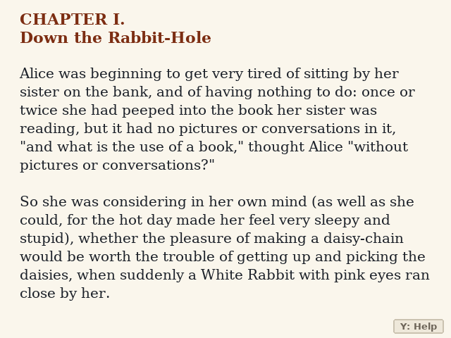 | 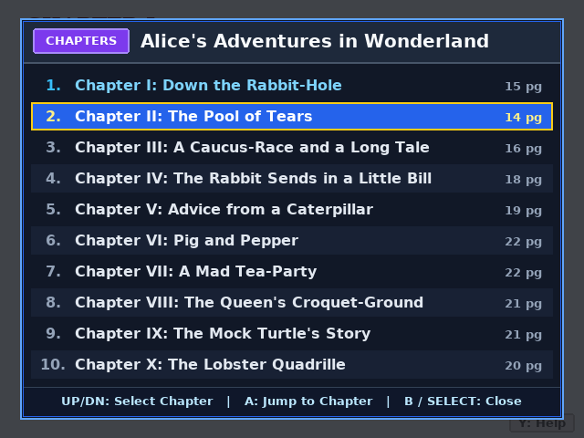 |

## [Boot Logo Customizer](boot_logo/)

A surgical boot logo modifier for Knulli Scarab on the RG 35xxSP that previews 5 `640x480` boot logos at 1:1 resolution, writes `/boot/bootlogo.bmp` with SHA-256 read-back verification, and preserves the original stock image for instant restoration.

## [Calc — Desk & Scientific Calculator](calc/)

A native `640x480` Desk (`BASIC`, 5x5) and Scientific (`SCI`, 5x8) calculator with 3D beveled keycaps, `DEG`/`RAD` trigonometry, nested parentheses (`L2`/`R2`), Memory (`MEM`), Last Answer (`ANS`), and zero external `.so` dependencies.

| Basic Calculator (`BASIC`) | Scientific Calculator (`SCI`) |
| :---: | :---: |
| 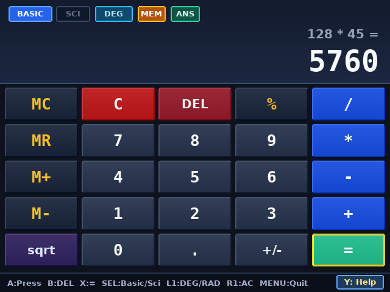 | 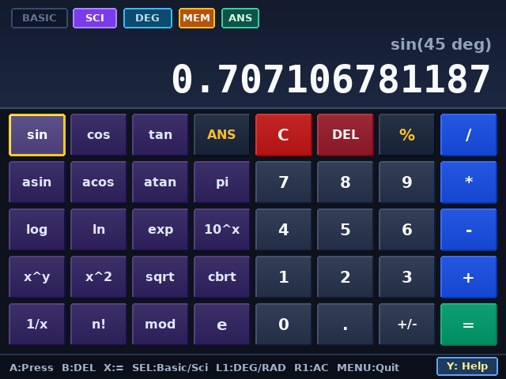 |

## [ChordWheel](chordwheel/)

An interactive Circle of Fifths, diatonic harmony explorer, 3-voicing CAGED guitar inspector, and 4-bar progression looper with 3 selectable guitar timbres (`Acoustic`, `Chorus Electric`, and `Nylon Arpeggio`) powered by background-thread SoundFont 2 + Extended Karplus-Strong synthesis.

| Diatonic Triads & Guitar Voicing (`Key of C`) | Diatonic 7th Chords (`Key of G`, `Chorus El`) |
| :---: | :---: |
| 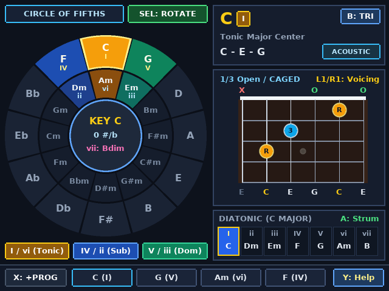 | 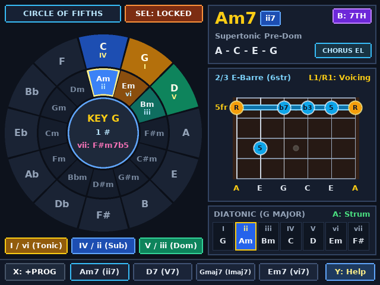 |

## [EarTrainer](eartrainer/)

A guitar ear trainer for intervals (`m2`-`P8` across `Easy`, `Medium`, and `All 12`) and chord qualities (`12` triad, suspended, and 7th types) featuring a 12-fret guitar neck, large-label `4x3` answer keypad with lifetime accuracy stats, and background-thread SoundFont 2 + EKS audio.

| Interval Quiz (`Awaiting Guess`) | Revealed Answer on 12-Fret Guitar Neck |
| :---: | :---: |
| 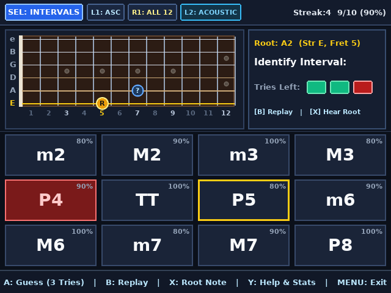 | 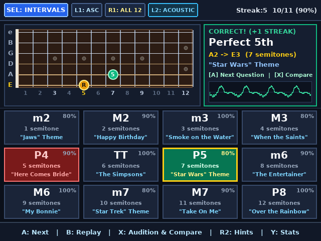 |

## [Fretboard](fretboard/)

An interactive 15-fret guitar neck encyclopedia (`Frets 0-15`), 5-position CAGED scale box visualizer, chord-voicing browser, and reverse chord finder supporting 6 guitar tunings (`Standard`, `Drop D`, `Eb`, `D Std`, `DADGAD`, `Open G`) with background-thread SoundFont 2 + EKS audio.

| Scales & CAGED Box View (`A Blues`, POS 1) | Chords & Arpeggios View (`Cmaj7`, Voicing 2) |
| :---: | :---: |
| 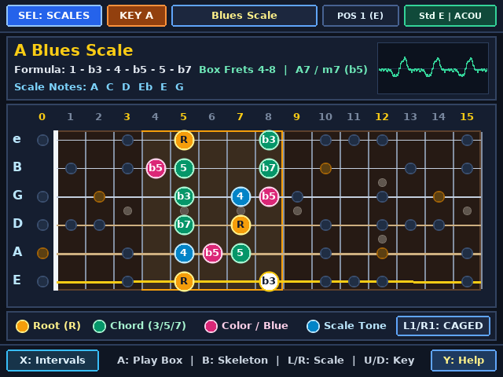 | 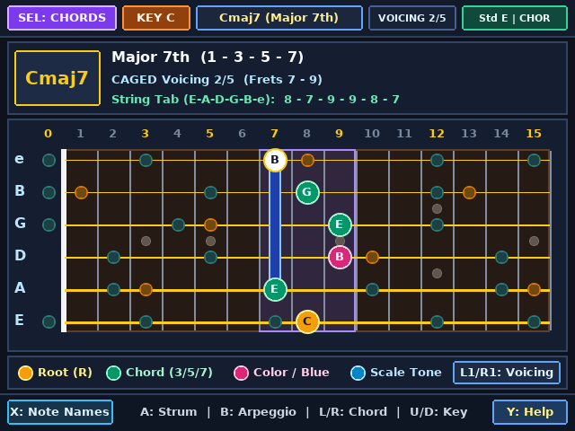 |

## [LickTrainer](licktrainer/)

A 6-string guitar tab player, live fretboard position coach, diatonic jazz 7th arpeggio trainer, and automated BPM speed-builder covering 33 curated exercises across 6 categories (`Pentatonic`, `Legato/Arp`, `Alt Pick`, `Blues/Rock`, `Spider`, `Jazz 7ths`) with 4-beat count-in and background-thread SoundFont 2 audio.

| Pentatonic Licks (`#05 Box 1 to 2 Slide`) | Jazz 7th Arpeggios (`#26 6th-Str Asc I-IV`) |
| :---: | :---: |
| 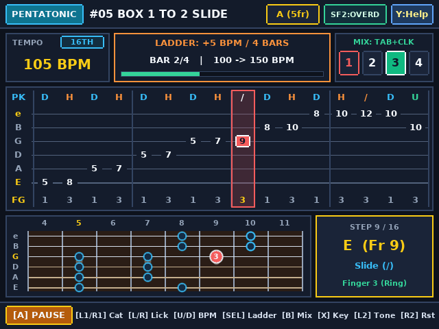 | 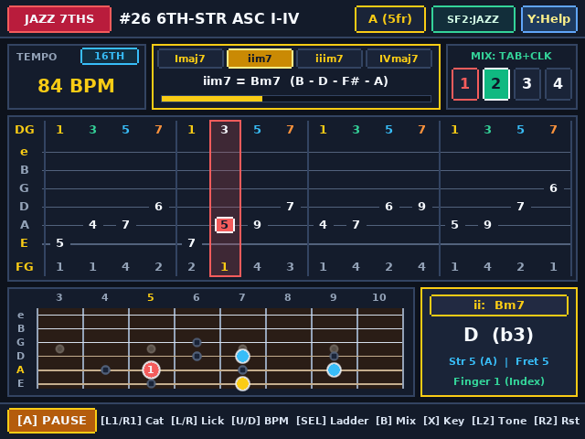 |

## [Metronome](metronome/)

A sample-accurate studio metronome (`30-260 BPM` with continuous tempo hold) supporting 5 time signatures (`4/4`, `3/4`, `2/4`, `5/4`, `7/4`), 4 click kits (`Woodblock`, `Drum Rim`, `Classic`, `Marimba`), and 4-bar lock-in stealth beat drop (`0%-100%`) on a dedicated background audio thread.

| Main Metronome View | Quick Guide & Controls (`Y`) |
| :---: | :---: |
| 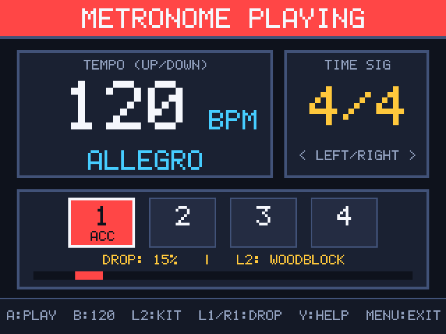 | 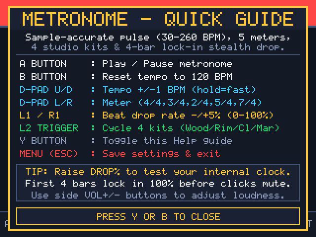 |

## [MusicPlayer](musicplayer/)

A distraction-free directory music player for `MP3`, `FLAC`, `OGG` Vorbis, and `WAV` with zero external `.so` dependencies, background-thread decoding, filename-order playlists, global hold-to-seek (`L1`/`R1`), and automatic `[RESUME]` right back to your last track and timestamp.

| Directory Browser (`[RESUME]`) | Now Playing (`FLAC`) & Playlist |
| :---: | :---: |
| 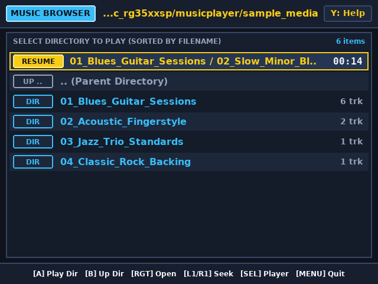 | 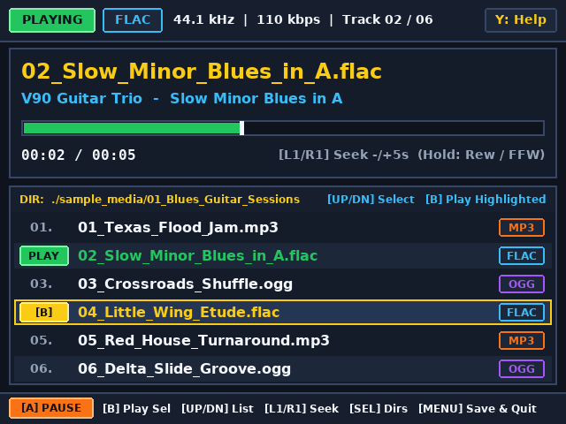 |

## [Night Clock](night_clock/)

A single-screen bedside and desk night clock with 24H retro LED dot-matrix digital and minimalist analog faces, 10-minute anti-burn-in orbit, app-local timezone shift (`TZ +/-`), hardware brightness and volume indicators, and a single-screen alarm editor.

| Retro LED Digital Clock (24H) | Minimalist Analog Clock |
| :---: | :---: |
| 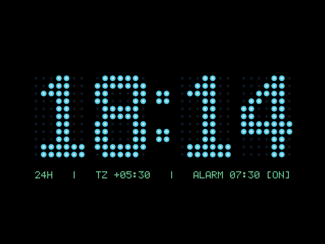 | 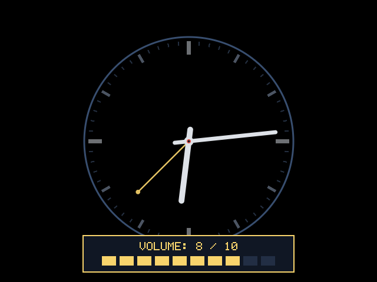 |

## [PocketBand](pocketband/)

A 5-track drum machine, walking bassline sequencer, stereo chord-comping backing band, and 12-fret guitar soloing map (`Blues`, `Rock`, and `Jazz` in `4/4` and `3/4`) with live per-track VU meters, interactive Swing/Auto-Fill groove settings, and SoundFont 2 (`pocketband.sf2` / `GeneralUser-GS.sf2`) background audio.

| Guitarist Jam View (`Blues Shuffle 4/4`) | 5-Track Step & Bassline Editor (`Classic Rock 4/4`) |
| :---: | :---: |
| 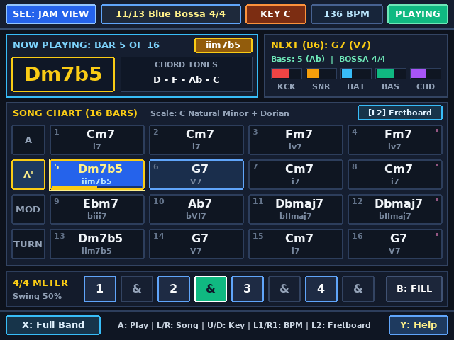 | 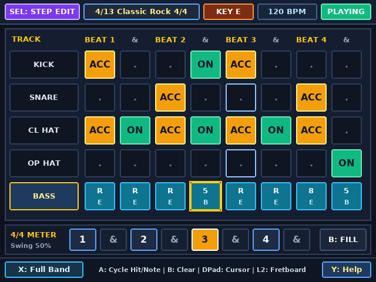 |

## [Pomodoro](pomodoro/)

A distraction-free Pomodoro focus timer (`Work`, `Short Break`, `Long Break`) with customizable durations, stereo SoundFont + singing-bowl completion chimes, Knulli haptic rumble alerts, persistent Today/All-Time work-hours logging, and automatic clamshell lid-close save.

| Active Focus Session | Quick Guide & Controls (`Y`) |
| :---: | :---: |
| 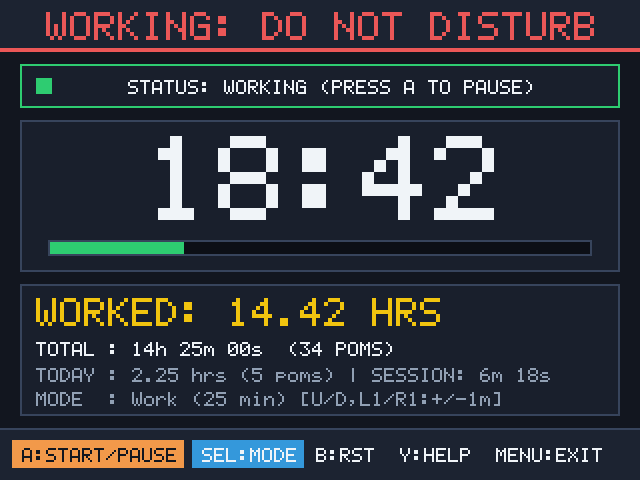 | 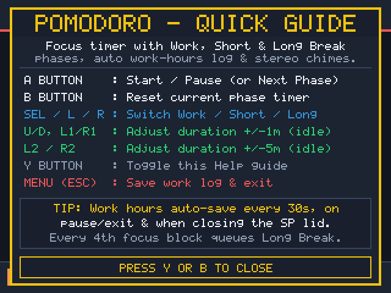 |

## [SightRead](sightread/)

A progressive guitar staff-to-fretboard sight-reading trainer with 99 deterministic 2-bar etudes across 4 difficulty tiers (`LVL1`-`LVL4`), 7 key signatures (`C` through `Eb`), 5 neck positions (`OPEN` through `POS 9`), engraved `8vb` treble clef notation, and background-thread SoundFont 2 guitar audio.

| Open Position (`EX #01`, `C Maj`) | Advanced 7th Position (`EX #16`, `Eb`) |
| :---: | :---: |
| 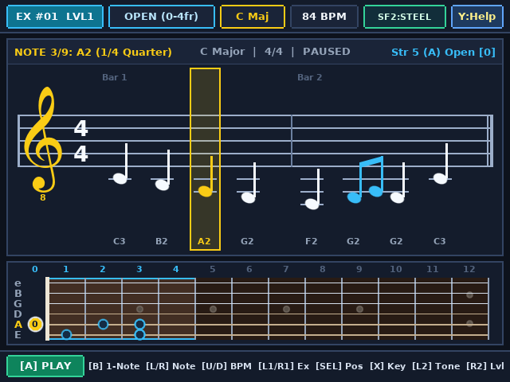 | 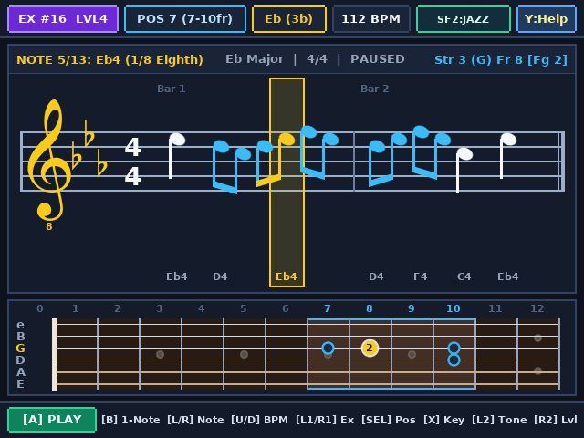 |
