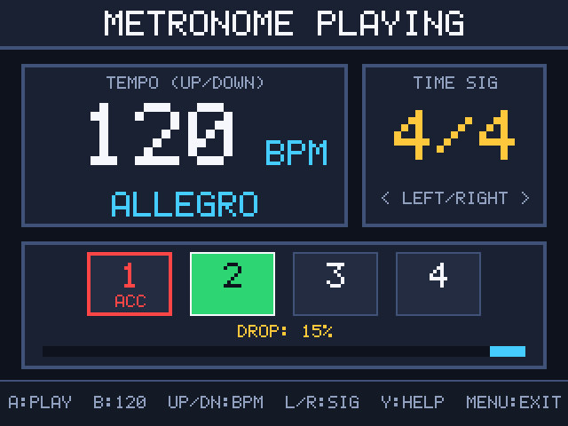
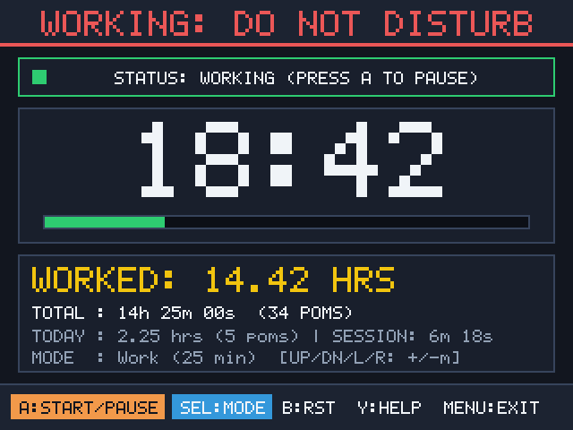
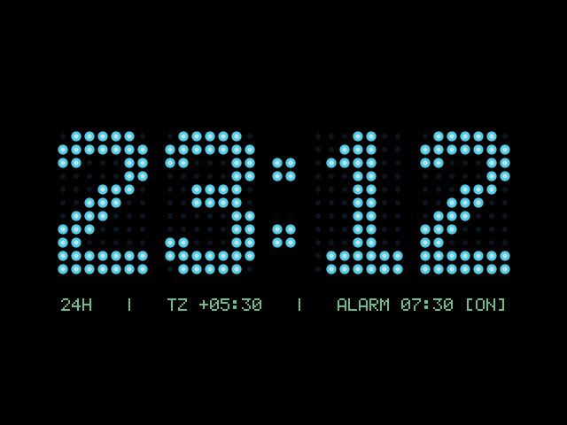
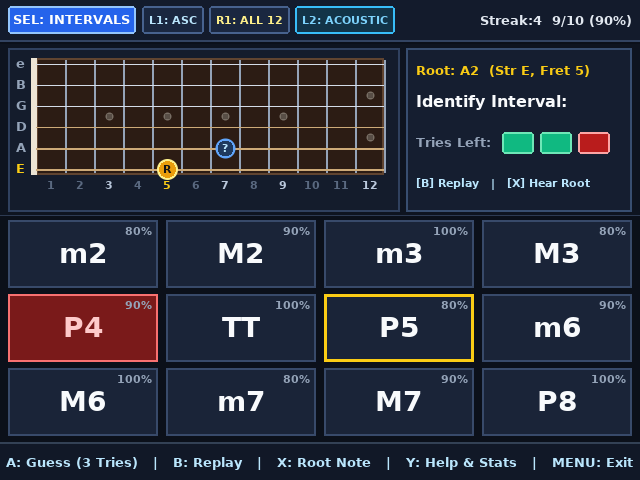
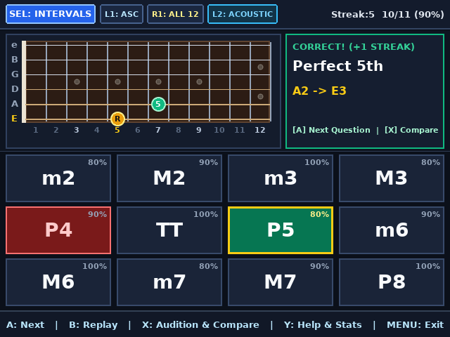
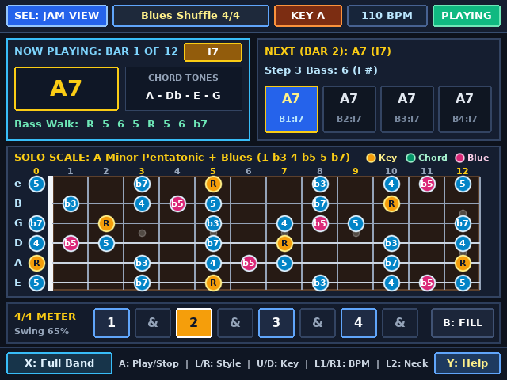
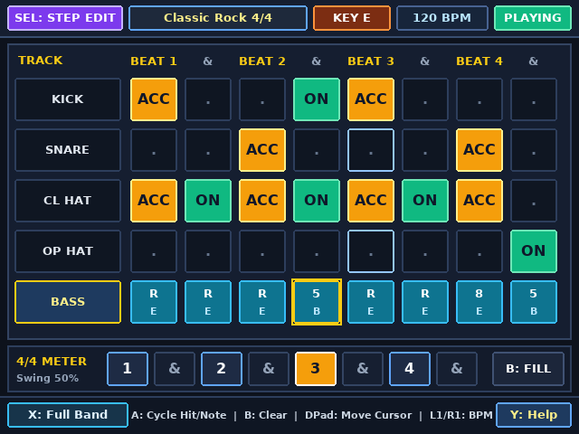

# Anbernic RG 35xxSP
Hand-written utilities for the Anbernic RG 35xxSP

The RG 35xxSP is just a simple Linux device. It can be used to play
retro games, but since it is a Linux machine, you can write simple
utilities that can be displayed on the screen, and controlled using
DPAD and A/B/X/Y keys.  I'm running Knulli, which is based on
Batocera, but this codebase is a good starting point even if you are
using the standard firmware, as it is a simple Linux ARM binary.

Here are a few utilities that can be built both for the machine, and
also compile natively on Linux x11 so you can test them out before
copying it on the SD-card for running on your RG 35xxSP.

## [Metronome](metronome/)

A simple metronome that shows some common time signatures, and plays a
tick on the beat.

## [Pomodoro](pomodoro/)

A work timer to let folks know that you are working.

## [Night Clock](night_clock/)

A single-screen bedside and desk night clock with 24H retro LED dot-matrix digital & minimalist analog modes, local timezone shift (`TZ +/-`), volume & brightness controls, and a single alarm.

## [Boot Logo Customizer](boot_logo/)

A surgical boot logo modifier for Knulli Scarab on the RG 35xxSP that previews 4 custom `640x480` boot logos at 1:1 resolution, writes `/boot/bootlogo.bmp` with SHA-256 read-back verification, and preserves the stock boot logo for instant restoration.

## [ChordWheel](chordwheel/)

An interactive Circle of Fifths, harmonic function wheel, guitar chord voicing inspector, and 4-bar progression looper rendered natively at `640x480` with a background 44.1 kHz floating-point Extended Karplus-Strong (EKS) 6-string guitar synthesizer (`Acoustic`, `Chorus Electric`, and `Nylon Arpeggio` timbres).

| Diatonic Triads & Guitar Voicing (`Key of C`) | Diatonic 7th Chords (`Key of G`, `Chorus El`) |
| :---: | :---: |
|  |  |

## [EarTrainer](eartrainer/)

A guitar ear-training trainer for intervals (`12` intervals across `Easy`, `Medium`, and `All 12`) and chord qualities (`12` triad, suspended & 7th voicings) featuring a `640x480` 12-fret guitar neck, `4x3` answer keypad grid with lifetime accuracy percentages, and a background 44.1 kHz floating-point EKS guitar synthesizer.

| Interval Quiz (`Awaiting Guess`) | Revealed Answer on 12-Fret Guitar Neck |
| :---: | :---: |
|  |  |

## [Fretboard](fretboard/)

An interactive 15-fret guitar neck encyclopedia (`Frets 0–15`), 5-position CAGED scale box visualizer, chord-voicing browser, and reverse chord finder supporting `6` guitar tunings (`Standard`, `Drop D`, `Eb`, `D Std`, `DADGAD`, `Open G`) and a background 44.1 kHz floating-point EKS guitar synthesizer.

| Scales & CAGED Box View (`A Blues`, POS 1) | Chords & Arpeggios View (`Cmaj7`, Voicing 2) |
| :---: | :---: |
|  |  |

## [PocketBand](pocketband/)

A 5-track drum machine, walking bassline sequencer, stereo chord-comping backing band, and 12-fret guitar soloing map (`Blues`, `Rock`, and `Jazz` in `4/4` and `3/4`) powered by a background 44.1 kHz floating-point multi-track synthesizer with live per-track VU meters.

| Guitarist Jam View (`Blues Shuffle 4/4`) | 5-Track Step & Bassline Editor (`Classic Rock 4/4`) |
| :---: | :---: |
|  |  |

