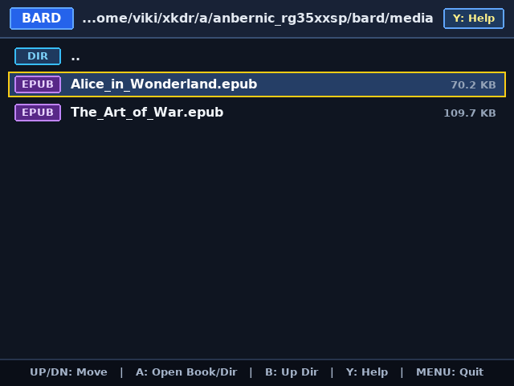
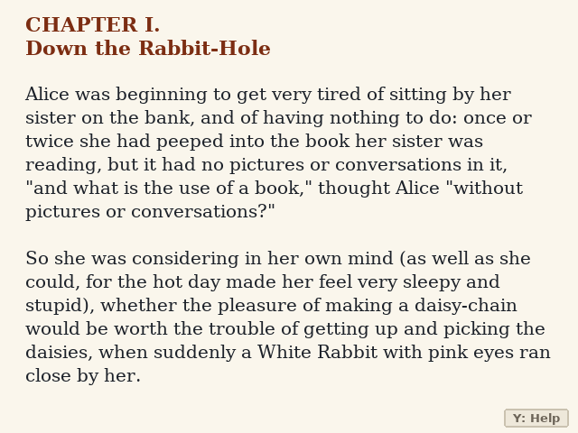
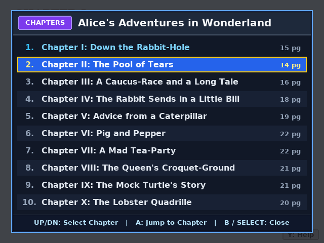
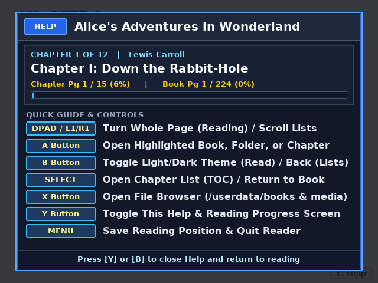

# Anbernic RG 35xxSP EPUB & Text Reader (`bard`, `640×480`)

A lightweight, distraction-free native **`640×480`** EPUB 2 / EPUB 3 & plain-text e-book reader ported to the **Anbernic RG 35xxSP** (Allwinner H700 64-bit quad-core ARM Cortex-A53) and **Linux Desktop (`x86_64` X11)** with **zero third-party `.so` dependencies**.

---

## Screenshots

| File Browser (`media/`) | Full-Screen Reading View | Chapter List (`SELECT`) | Help & Progress (`Y`) |
| :---: | :---: | :---: | :---: |
|  |  |  |  |

---

## Key Features

1. **Zero External `.so` Dependencies (`miniz` + Pure-C XML/XHTML Parser)**:
   - Statically compiles `../third_party/miniz.c` to read compressed `.epub` archives directly in memory without extracting temporary files.
   - Built-in pure-C XML / XHTML DOM parser supporting `META-INF/container.xml`, `.opf` metadata/manifest/spine, **EPUB 2 `toc.ncx`**, **EPUB 3 `<nav epub:type="toc">`**, fragment boundaries, HTML/XML named & numeric entities (`&mdash;`, `&ldquo;`, `&rsquo;`, `&nbsp;`, `&#...;`, `&#x...;`), and UTF-8 punctuation normalization while skipping `<head>`, `<style>`, `<script>`, ``, and `<svg>`.
   - Supports plain `.txt` books with automatic paragraph reflowing.
2. **Crisp `640×480` Book Typography**:
   - Anti-aliased **20px `DejaVuSerif`** body typography and **22px `DejaVuSerif-Bold`** headings with `28 px` left/right margins (`584 px` column, `17` lines per page, zero horizontal scrolling).
   - Full-screen distraction-free reading view with only a discrete **`Y: Help`** pill in the bottom-right corner and one-button **Light Paper / Dark Night** theme switching (`B`).
3. **Whole-Page Vertical Scrolling, Chapter List & Persistent Resume**:
   - Static whole-page scrolling via **`DPAD DOWN` / `UP`** (or `R1` / `L1`) with automatic chapter transitions.
   - Interactive **Chapter List (`SELECT`)** showing chapter page counts and instant chapter jumping.
   - Automatically saves the active book, chapter, page, and theme to `.bard_rg35xxsp.cfg` and resumes right where you left off. Searches `/userdata/books`, `/userdata/media`, and `./media` when no saved book exists.

---

## Controls

| Mode | Action | Anbernic RG 35xxSP Button | Linux Desktop Key (`bard_linux`) |
| :--- | :--- | :--- | :--- |
| **Reading View** | Scroll One Whole Page Down / Up | **D-Pad DOWN / UP**, **RIGHT / LEFT**, or **R1 / L1** | `Down`/`Right`/`PgDn` and `Up`/`Left`/`PgUp` |
| **Reading View** | Toggle Light Paper <-> Dark Night Theme | **B** | `B` or `Backspace` |
| **Reading View** | Open Chapter List (Table of Contents) | **SELECT** | `Tab` |
| **Reading View** | Open File Browser | **X** | `X` |
| **File Browser** | Move Selection / Page Jump | **D-Pad UP / DOWN** (`L1`/`R1` page) | `Up` / `Down Arrow` (`PgUp`/`PgDn`) |
| **File Browser** | Open Book or Enter Folder | **A** | `A`, `Space`, or `Z` |
| **File Browser** | Go Up to Parent Directory (`..`) | **B** (or `LEFT`) | `B`, `Backspace`, or `Left Arrow` |
| **File Browser** | Return to Currently Open Book | **SELECT** | `Tab` |
| **Chapter List** | Highlight Chapter (`L1`/`R1` page) & Jump | **D-Pad UP / DOWN** + **A** | `Up` / `Down Arrow` + `A`/`Space` |
| **Chapter List** | Close Chapter List | **B** or **SELECT** | `B`, `Backspace`, or `Tab` |
| **All Views** | Toggle Help & Progress Overlay | **Y** | `Y` |
| **All Views** | Save Reading Position & Quit | **MENU** | `Esc` |

---

## Building & Testing

```bash
cd bard
make all
make test
```

- **RG 35xxSP Binary & SD Card Package**: `sdcard_package/roms/ports/Bard.sh` and `sdcard_package/roms/ports/bard/` (bundled with `Alice_in_Wonderland.epub` and `The_Art_of_War.epub`)
- **Linux Desktop X11 Simulator**: `./bard_linux` (or `make run-linux`)
- **Automated Screenshots**: `./bard_linux --screenshot /tmp ./media`
