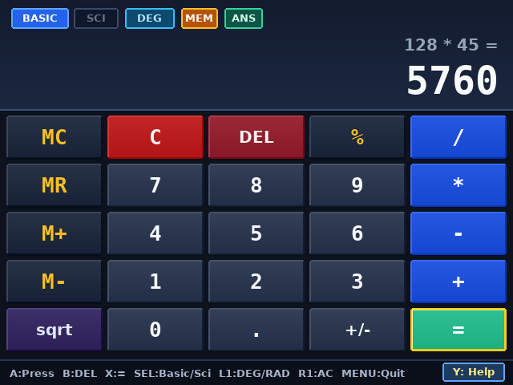
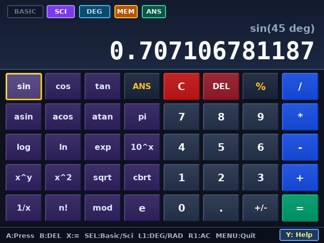
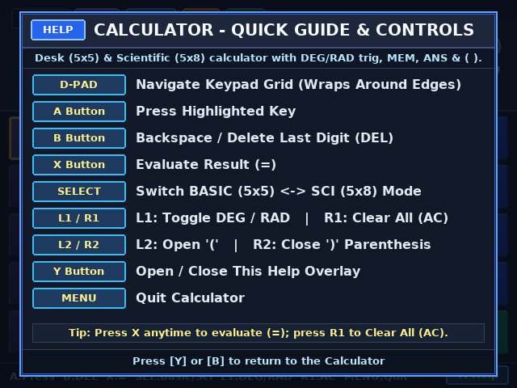

# Anbernic RG 35xxSP Desk & Scientific Calculator (`calc`, `640×480`)

A native **`640×480`** 32-bit true-color **Desk (`BASIC`) & Scientific (`SCI`) Calculator** ported to the **Anbernic RG 35xxSP** (Allwinner H700 64-bit quad-core ARM Cortex-A53) and **Linux Desktop (`x86_64` X11)** with zero third-party `.so` dependencies.

---

## Screenshots

| Basic Calculator (`BASIC`, 5×5) | Scientific Calculator (`SCI`, 5×8) | Help Overlay (`Y`) |
| :---: | :---: | :---: |
|  |  |  |

---

## Features

1. **Native `640×480` High-Contrast Display & 3D Beveled Keycaps**:
   - Edge-to-edge **`640×136`** top expression and hero numeric readout with crisp anti-aliased **48px** bold monospace digits (`DejaVuSansMono-Bold`), auto-scaling gracefully for long results.
   - Status pills for **`BASIC` / `SCI`** mode, **`DEG` / `RAD`** angle unit, Memory (**`MEM`**), Last Answer (**`ANS`**), and open parenthesis nesting depth.
   - Color-coded 3D beveled keycaps with a golden-amber focus ring (`#FACC15`) and glowing pending-operator highlight.
2. **Dual Modes (`BASIC` 5×5 & `SCI` 5×8)**:
   - Press **`SELECT`** (`Tab` on desktop) at any time to switch between `BASIC` (5×5 with `MC`/`MR`/`M+`/`M-`/`sqrt`) and `SCI` (5×8) while preserving cursor alignment on the numpad.
   - Full `<math.h>` scientific suite: `sin`, `cos`, `tan`, `asin`, `acos`, `atan` (in `DEG` or `RAD` with exact zero/asymptote handling), `log`, `ln`, `exp`, `10^x`, `x^y`, `x^2`, `sqrt`, `cbrt`, `1/x`, `n!`, `mod`, `pi`, `e`, `ANS`, memory registers, and nested parentheses (`L2` / `R2`).
3. **Zero External Dependencies**:
   - Loads `libSDL2-2.0.so.0` dynamically via `dlopen` with automatic `/dev/fb0` fallback and direct Linux `evdev` hardware input (`../rg35xxsp_input.h`).

---

## Controls

| Action | Anbernic RG 35xxSP Button | Linux Desktop Key (`calc_linux`) |
| :--- | :--- | :--- |
| **Navigate Keypad Grid** | **D-Pad (`UP`/`DOWN`/`LEFT`/`RIGHT`)** | `Arrow Keys` |
| **Press Highlighted Key** | **A** | `A`, `Space`, or `Z` |
| **Backspace / Delete Last Digit (`DEL`)** | **B** | `B` or `Backspace` |
| **Evaluate (`=`)** | **X** | `X` |
| **Toggle `BASIC` ↔ `SCI` Mode** | **SELECT** | `Tab` |
| **Toggle `DEG` ↔ `RAD`** | **L1** | `L`, `Q`, `[`, or `Page Up` |
| **Clear All (`AC`)** | **R1** | `R`, `E`, `]`, or `Page Down` |
| **Open `(` / Close `)` Parenthesis** | **L2** / **R2** | `1` / `2` |
| **Toggle Help Overlay** | **Y** | `Y` |
| **Quit Calculator** | **MENU** | `Esc` |

> **Desktop Tip**: On Linux Desktop (`calc_linux`), you can also type digits (`0`, `3`-`9`, or Numpad `0`-`9`), `.`, `+`, `-`, `*`, `/`, `^`, `%`, `=`, `(`, and `)` directly from your keyboard (`1` and `2` on the top number row map to `L2` / `R2` parentheses).

---

## Building & Testing

```bash
cd calc
make all
make test
```

- **RG 35xxSP Binary & SD Card Package**: `sdcard_package/roms/ports/Calc.sh` and `sdcard_package/roms/ports/calc/calc`
- **Linux Desktop X11 Simulator**: `./calc_linux` (or `make run-linux`)
- **Automated Screenshots**: `./calc_linux --screenshot /tmp`
