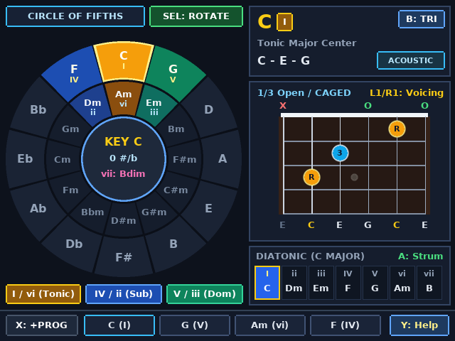
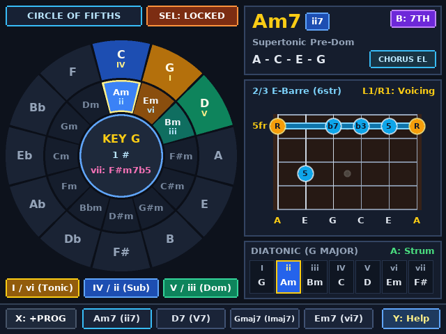
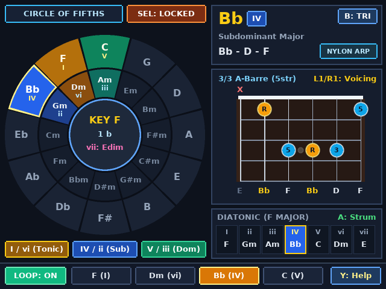
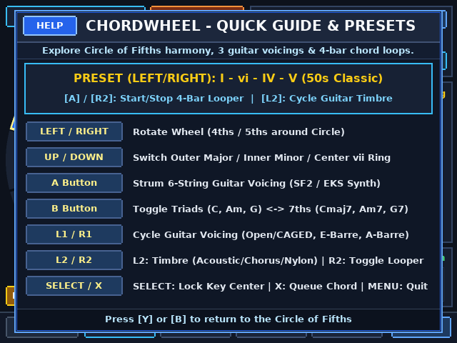

# Anbernic RG 35xxSP Interactive Guitar ChordWheel (`640x480`)

An interactive **Circle of Fifths, Diatonic Harmony Explorer, CAGED Guitar Voicing Inspector, and 4-Bar Progression Looper** built natively for the **Anbernic RG 35xxSP** (Allwinner H700 64-bit quad-core ARM Cortex-A53, `640x480` IPS display) and **x86_64 Linux (X11)**.

---

## Screenshots

| Circle of Fifths & Open Voicing (`Key of C`) | Diatonic 7th Chords (`Key of G`, `Chorus El`) |
| :---: | :---: |
|  |  |

| 4-Bar Auto-Strum Progression Looper (`R2`) | Quick Guide & Progression Presets (`Y`) |
| :---: | :---: |
|  |  |

---

## Key Features

1. **44.1 kHz Stereo SoundFont 2 + Extended Karplus-Strong (EKS) Background Audio Engine**:
   - Loads **`GeneralUser-GS.sf2`** (or `pocketband.sf2`) automatically via `../rg35xxsp_sf2.h` with stereo room reverb, falling back seamlessly to a 6-string floating-point **Extended Karplus-Strong** waveguide guitar synthesizer with dual-biquad acoustic body resonance.
   - Includes **3 selectable guitar timbres (`L2`)**: **Acoustic Dreadnought**, **Chorus Electric** (stereo modulated LFO chorus), and **Nylon Arpeggio** (warm classical fingerpicked roll).
   - Runs entirely on a **dedicated background audio thread** driven by a lock-free atomic ring buffer (`queue_strum()`), keeping the `640x480` UI smooth at 60 FPS.
2. **Native `640x480` Circle of Fifths & 3-Card Guitar Inspector**:
   - **3-Ring Circle of Fifths (`R=156 px`)**: Outer Major ring, Inner Relative Minor ring, and Center Diminished (`vii°`) ring with diatonic Roman numeral badges (`I`, `ii`, `iii`, `IV`, `V`, `vi`, `vii°`).
   - **Harmonic Function & Spelling Card**: Displays chord symbol, Roman numeral role, note spelling, triad/7th toggle, and active guitar timbre.
   - **Interactive 6-String Rosewood Fretboard**: Cycles **3 movable guitar voicings per chord (`L1`/`R1`)** (*Open/CAGED*, *6-string E-shape barre*, *5-string A-shape barre*) with color-coded interval badges (`R`, `3`/`b3`, `5`/`b5`, `7`/`b7`).
   - **Diatonic Strip & 4-Bar Progression Looper**: Queue any chord with **`X`**, pick classic presets inside **`Y`** Help (`LEFT`/`RIGHT`), and loop all 4 bars automatically with **`R2`**.
3. **Standard RG 35xxSP Controls & Persistence**:
   - Uses `../rg35xxsp_input.h` for consistent RG 35xxSP `evdev` and Desktop X11 controls, saving your active key, timbre, and voicing across launches.

---

## Controls

| Action | Anbernic RG 35xxSP Button | Linux Desktop Key (`chordwheel_linux`) |
| :--- | :--- | :--- |
| **Rotate Wheel Counter-Clockwise (4ths) / Clockwise (5ths)** | **D-Pad LEFT** / **RIGHT** | `Left Arrow` / `Right Arrow` |
| **Switch Ring (Outer Major <-> Inner Minor <-> Center `vii°`)** | **D-Pad UP** / **DOWN** | `Up Arrow` / `Down Arrow` |
| **Strum Selected 6-String Guitar Voicing** | **A** | `A`, `Space`, `Z`, or `Alt` |
| **Toggle Triads (`C, Am, G`) <-> 7th Chords (`Cmaj7, Am7, G7`)** | **B** | `B`, `Backspace`, or `Ctrl` |
| **Append Current Chord to 4-Slot Progression Bar** | **X** | `X` |
| **Cycle Guitar Voicing (`Open/CAGED` <-> `E-Barre` <-> `A-Barre`)** | **L1** / **R1** | `L`/`Q`/`[`/`PgUp` and `R`/`E`/`]`/`PgDn` |
| **Cycle Guitar Timbre (`Acoustic` <-> `Chorus El` <-> `Nylon Arp`)** | **L2** | `1` |
| **Start / Stop 4-Bar Progression Auto-Looper** | **R2** | `2` |
| **Lock / Unlock Active Key Center (`ROTATE` <-> `LOCKED`)** | **SELECT** | `Tab` |
| **Open / Close Quick Guide & Progression Presets** (`L/R` preset, `A` loop, `Y`/`B` close) | **Y** | `Y` |
| **Save State & Exit** | **MENU (`M`)** | `Esc` |

---

## Building & Running

```bash
cd chordwheel
make all
```
- **RG 35xxSP Binary & SD Card Package**: `sdcard_package/roms/ports/ChordWheel.sh` and `sdcard_package/roms/ports/chordwheel/chordwheel`
- **SoundFont (Recommended)**: Copy `../soundfonts/GeneralUser-GS.sf2` to `/userdata/roms/ports/soundfonts/GeneralUser-GS.sf2` on your SD card.
- **Linux Desktop X11 Simulator**: `./chordwheel_linux` (or `make run-linux`)
