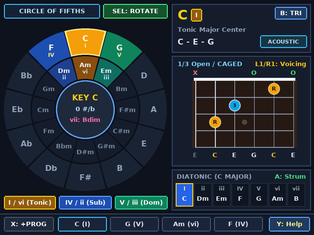
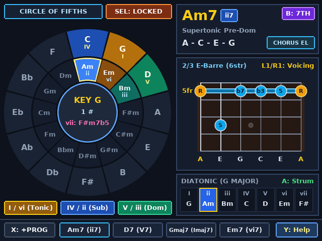
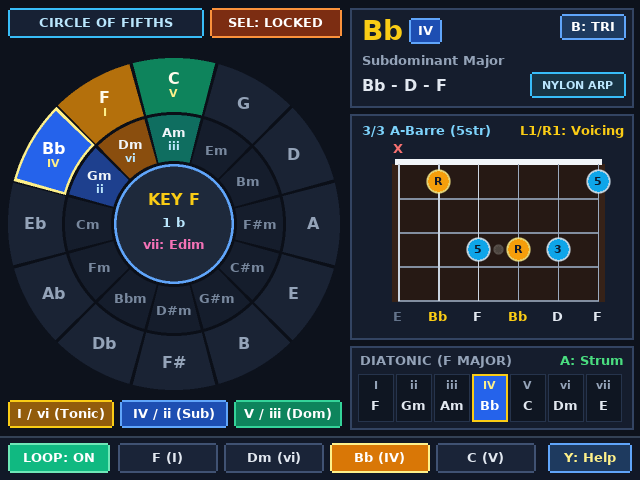
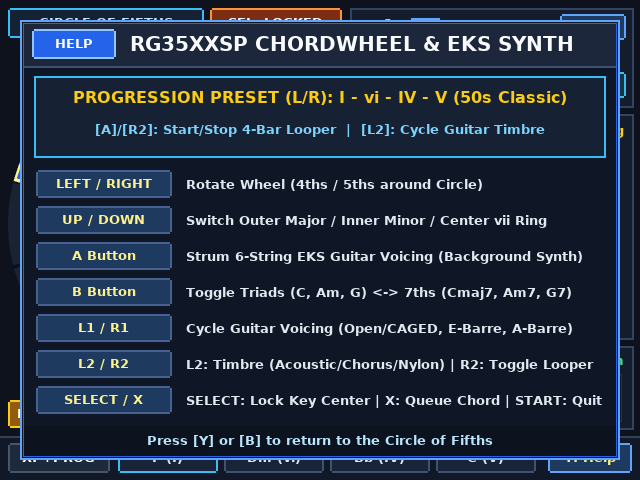

# Anbernic RG 35xxSP Interactive Guitar ChordWheel (`640×480`)

An interactive **Circle of Fifths, Diatonic Harmony Explorer, CAGED Guitar Voicing Inspector, and 4-Bar Progression Looper** rewritten natively for the **Anbernic RG 35xxSP** (Allwinner H700 64-bit quad-core ARM Cortex-A53, `640×480` IPS display) and **x86_64 Linux (X11)**.

---

## Screenshots

### 1. Circle of Fifths & Open CAGED Voicing (Key of C Major)


### 2. Jazz 7th Chords (`B`), Locked Key (`SELECT`), 6-String E-Barre Voicing & Chorus Electric Timbre


### 3. 4-Bar Auto-Strum Progression Looper (`R2`) & Nylon Arpeggio Timbre (`L2`)


### 4. Interactive Help & Progression Preset Selector (`Y`)


---

## Key Upgrades for the Anbernic RG 35xxSP

1. **64-Bit Floating-Point Extended Karplus-Strong (EKS) Audio Engine (44.1 kHz Stereo)**:
   - Exploits the RG 35xxSP's 64-bit Cortex-A53 hardware FPU to run 6 simultaneous floating-point **Extended Karplus-Strong** waveguide string models with first-order Thiran **all-pass fractional delay interpolation** (eliminating pitch quantization on high frets), pick-position comb filtering, two-stage loop damping, and **dual-biquad acoustic guitar body resonance filters** (`~102 Hz` Helmholtz air cavity and `~215 Hz` spruce top plate).
   - Includes **3 selectable guitar timbres (`L2`)**: **Acoustic Dreadnought** (natural strum), **Chorus Electric** (stereo modulated LFO chorus), and **Nylon Arpeggio** (warm classical fingerpicked roll).
2. **Asynchronous Background Audio Synthesis Thread**:
   - All waveguide string excitation, staggered strum scheduling, 4-bar progression auto-looper timing, biquad body filtering, and stereo chorus processing run continuously inside a **dedicated background audio thread**.
   - The UI thread communicates with the synth via a lock-free atomic command ring buffer (`queue_strum()`), keeping the `640×480` UI completely non-blocking and responsive at 60 FPS.
3. **Native `640×480` High-Resolution Display & Anti-Aliased Typography**:
   - Renders a large anti-aliased **3-ring Circle of Fifths** (`R=156 px`) on the left alongside a **3-card Guitar Inspector** on the right:
     1. **Harmonic Function & Spelling Card**: Displays chord symbol, Roman numeral badge, functional harmony role, note spelling, triad/7th indicator, and active timbre badge.
     2. **Interactive 6-String Rosewood Fretboard**: Displays **3 movable voicings per chord (`L1`/`R1`)** (Open/CAGED, 6-string E-shape barre, 5-string A-shape barre) centered with wide 40 px string spacing and color-coded interval badges (`R`, `3`/`b3`, `5`/`b5`, `7`/`b7`).
     3. **Diatonic Scale Strip (`I` – `vii°`) & 4-Bar Progression Bar**: Highlights all 7 diatonic chords in the active key at a glance alongside the 4-slot progression looper bar at the bottom.
4. **Hardware-Accurate RG 35xxSP & Desktop Keyboard Controls**:
   - Supports the Anbernic RG 35xxSP's `evdev` keycodes (`304`=A, `305`=B, `306`=Y, `307`=X, `308`=L1, `309`=R1, `310`=SELECT, `311`=START, `312`=L2, `313`=R2, `316`=MENU) as well as intuitive desktop keyboard keys (`A`, `B`, `X`, `Y`, `L`, `R`, `1`, `2`, `Tab`, `Enter`, cursor arrows) in `chordwheel_linux`.

---

## Controls

| Action | Anbernic RG 35xxSP Button | Linux Desktop Key (`chordwheel_linux`) |
| :--- | :--- | :--- |
| **Rotate Wheel Counter-Clockwise (4ths) / Clockwise (5ths)** | **D-Pad LEFT** / **RIGHT** | `Left Arrow` / `Right Arrow` |
| **Switch Ring (Outer Major ↔ Inner Minor ↔ Center `vii°`)** | **D-Pad UP** / **DOWN** | `Up Arrow` / `Down Arrow` |
| **Strum Selected 6-String Guitar Voicing** | **A** | `A` (or `Space` / `Z`) |
| **Toggle Triads (`C, Am, G`) ↔ 7th Chords (`Cmaj7, Am7, G7`)** | **B** | `B` (or `Backspace`) |
| **Append Current Chord to 4-Slot Progression Bar** | **X** | `X` |
| **Open / Close Help & Progression Preset Selector** | **Y** | `Y` (or `H`) |
| **Cycle Guitar Voicing (`Open/CAGED` ↔ `E-Barre` ↔ `A-Barre`)** | **L1** / **R1** | `L` / `R` (or `Q` / `E`, `[` / `]`) |
| **Cycle Guitar Timbre (`Acoustic` ↔ `Chorus El` ↔ `Nylon Arp`)** | **L2** | `1` |
| **Start / Stop 4-Bar Progression Auto-Looper** | **R2** | `2` |
| **Lock / Unlock Active Key Center (`ROTATE` ↔ `LOCKED`)** | **SELECT** | `Tab` |
| **Save State & Exit** | **START** or **MENU** | `Enter`, `M`, or `ESC` |

---

## Building & Running

```bash
cd chordwheel
make all
```
- **RG 35xxSP Binary & SD Card Package**: `sdcard_package/roms/ports/ChordWheel.sh` and `sdcard_package/roms/ports/chordwheel/chordwheel`
- **Linux Desktop X11 Simulator**: `./chordwheel_linux` (or `make run-linux`)
