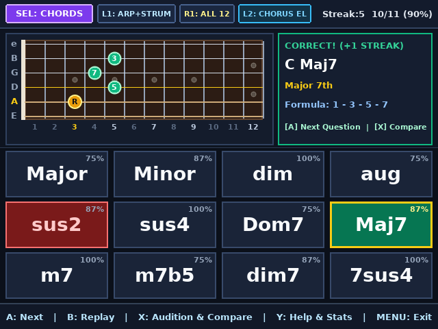
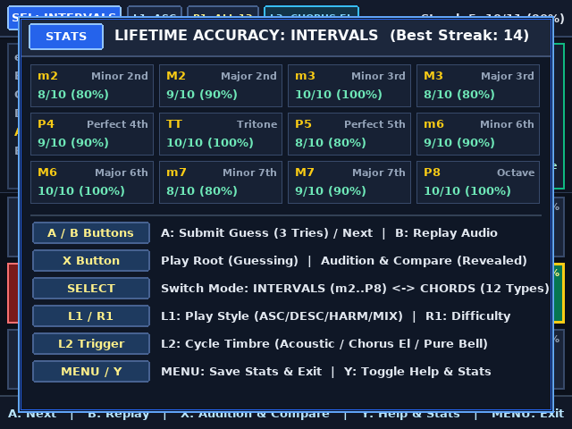

# Anbernic RG 35xxSP Guitar Interval & Chord Ear Trainer (`640×480`)

A guitar-focused **Interval (`m2`–`P8`) and Chord Quality (`Major`, `Minor`, `dim`, `aug`, `sus2`, `sus4`, `Dom7`, `Maj7`, `m7`, `m7b5`, `dim7`, `7sus4`) Ear Trainer** rewritten natively for the **Anbernic RG 35xxSP** (Allwinner H700 64-bit quad-core ARM Cortex-A53, `640×480` IPS display) and **x86_64 Linux (X11)**.

---

## Screenshots

### 1. Interval Guessing Mode (`INTERVALS` — 3 Tries & Fretboard Root)


### 2. Interval Revealed (`P5` — Fretboard Shape, Degree Badge & Song Mnemonic)


### 3. Chord Quality Mode (`CHORDS` — Moveable 4-String `C Maj7` Voicing & Chorus Electric Timbre)


### 4. Lifetime Accuracy Statistics & Controls Reference (`Y`)


---

## Key Upgrades for the Anbernic RG 35xxSP

1. **64-Bit Floating-Point Extended Karplus-Strong (EKS) Audio Engine (44.1 kHz Stereo)**:
   - Uses the RG 35xxSP's Cortex-A53 hardware FPU to run 6 polyphonic floating-point waveguide guitar strings with first-order Thiran all-pass fractional delay interpolation, pick-position comb filtering, dual-biquad acoustic body resonance (`~102 Hz` air cavity and `~215 Hz` top plate), and stereo modulated chorus.
   - Adds **3 selectable ear-training timbres (`L2`)**: **Acoustic Dreadnought** (`ACOUSTIC`), **Chorus Electric** (`CHORUS EL`), and **Pure Harmonic Bell** (`PURE BELL`).
2. **Asynchronous Background Audio Synthesis Thread**:
   - Note scheduling (`ASC`, `DESC`, `HARM`, `MIX`, `ARP+STRUM`, `STRUM`, `ARPEGGIO`), string excitation, and biquad body filtering run inside a **dedicated background audio thread** driven via a lock-free atomic command ring buffer (`post_audio_batch()`), keeping the `640×480` UI completely non-blocking at 60 FPS.
3. **Native `640×480` High-Resolution Display**:
   - **12-Fret 6-String Rosewood Fretboard (`E A D G B e`)**: Displays realistic bronze/steel string gauges, anti-aliased fret markers (`R` in gold, target interval or 4-string chord shape in emerald green or audition blue with interval degree badges `R`, `3`, `5`, `7`), and fret numbers `1`–`12`.
   - **Inspector Card**: Shows the root note string/fret, remaining guess pips, full interval/chord spelling, and classic song mnemonic.
   - **High-Visibility 4×3 Answer Keypad Grid**: Each of the 12 cards displays the interval/chord label in large `28px` typography (`m2`, `M2`, `m3`, `M3`, etc.) along with your lifetime accuracy percentage for that item.
4. **Hardware-Accurate RG 35xxSP & Desktop Keyboard Controls**:
   - Maps all RG 35xxSP `evdev` buttons (`304`=A, `305`=B, `306`=Y, `307`=X, `308`=L1, `309`=R1, `310`=SELECT, `311`=START, `312`=L2, `313`=R2, `316`=MENU) and desktop keyboard keys (`A`, `B`, `X`, `Y`, `L`, `R`, `1`, `2`, `Tab`, `Enter`, cursor arrows).

---

## Controls

| Action | Anbernic RG 35xxSP Button | Linux Desktop Key (`eartrainer_linux`) |
| :--- | :--- | :--- |
| **Navigate 4×3 Answer Grid** | **D-Pad UP / DOWN / LEFT / RIGHT** | `Cursor Arrow Keys` |
| **Submit Guess (3 Tries) / Next Question** | **A** | `A` (or `Space` / `Z`) |
| **Replay Current Question Audio** | **B** | `B` (or `Backspace`) |
| **Play Root Note (Guessing) / Audition & Compare Cell (Revealed)** | **X** | `X` |
| **Open / Close Lifetime Accuracy Stats & Help** | **Y** | `Y` (or `H`) |
| **Switch Trainer Mode (`INTERVALS` ↔ `CHORDS`)** | **SELECT** | `Tab` |
| **Cycle Playback Style (`ASC`/`DESC`/`HARM`/`MIX` or `ARP+STRUM`)** | **L1** | `L` (or `Q` / `[`) |
| **Cycle Difficulty Tier (`EASY` / `MEDIUM` / `ALL 12`)** | **R1** | `R` (or `E` / `]`) |
| **Cycle Instrument Timbre (`ACOUSTIC` / `CHORUS EL` / `PURE BELL`)** | **L2** | `1` |
| **Toggle Song Mnemonic / Chord Subtitle Hints** | **R2** | `2` |
| **Save Stats & Exit** | **START** or **MENU** | `Enter`, `M`, or `ESC` |

---

## Building & Running

```bash
cd eartrainer
make all
```
- **RG 35xxSP Binary & SD Card Package**: `sdcard_package/roms/ports/EarTrainer.sh` and `sdcard_package/roms/ports/eartrainer/eartrainer`
- **Linux Desktop X11 Simulator**: `./eartrainer_linux` (or `make run-linux`)
