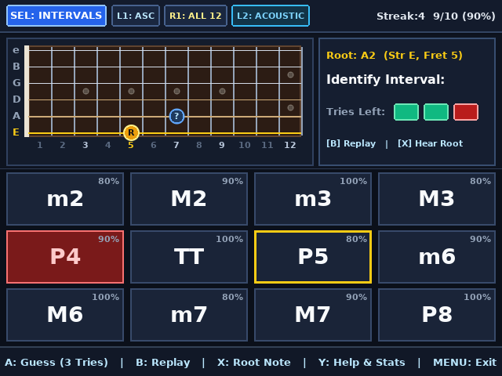
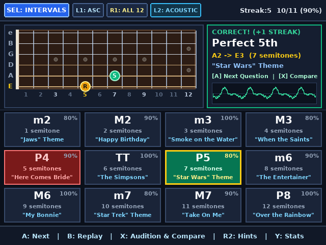
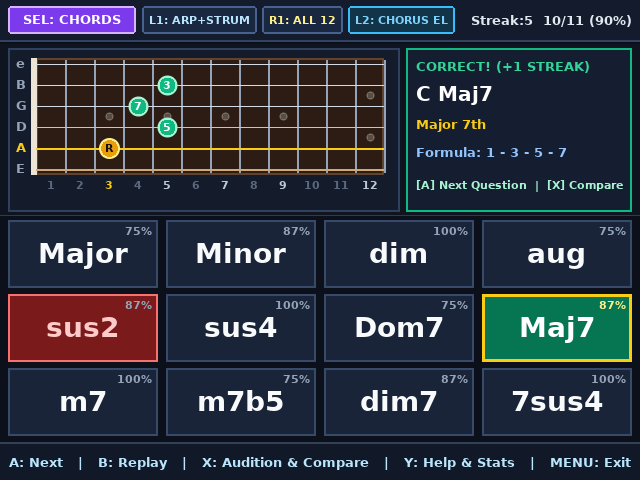
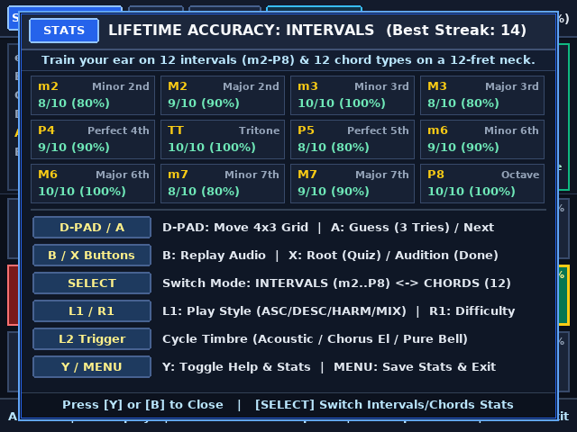

# Anbernic RG 35xxSP Guitar Interval & Chord Ear Trainer (`640x480`)

A guitar-focused **Interval (`m2`-`P8`) and Chord Quality (`Major`, `Minor`, `dim`, `aug`, `sus2`, `sus4`, `Dom7`, `Maj7`, `m7`, `m7b5`, `dim7`, `7sus4`) Ear Trainer** built natively for the **Anbernic RG 35xxSP** (Allwinner H700 64-bit quad-core ARM Cortex-A53, `640x480` IPS display) and **x86_64 Linux (X11)**.

---

## Screenshots

| Interval Quiz (`Awaiting Guess`) | Interval Revealed (`P5` on 12-Fret Neck) |
| :---: | :---: |
|  |  |

| Chord Quality Mode (`C Maj7`, `Chorus El`) | Lifetime Accuracy Stats & Quick Guide (`Y`) |
| :---: | :---: |
|  |  |

---

## Key Features

1. **44.1 kHz Stereo SoundFont 2 + Extended Karplus-Strong (EKS) Background Audio Engine**:
   - Loads **`GeneralUser-GS.sf2`** (or `pocketband.sf2`) automatically via `../rg35xxsp_sf2.h` with stereo room reverb, falling back seamlessly to a 6-voice floating-point **Extended Karplus-Strong** guitar synthesizer with dual-biquad body resonance.
   - Includes **3 selectable timbres (`L2`)**: **Acoustic Dreadnought** (`ACOUSTIC`), **Chorus Electric** (`CHORUS EL`), and **Pure Harmonic Bell** (`PURE BELL`).
   - All note scheduling (`ASC`, `DESC`, `HARM`, `MIX`, `ARP+STRUM`, `STRUM`, `ARPEGGIO`) and synthesis run asynchronously on a **dedicated background audio thread** via a lock-free atomic command ring buffer (`post_audio_batch()`).
2. **Native `640x480` Guitar Neck & Large `28px` Answer Keypad**:
   - **12-Fret 6-String Rosewood Fretboard (`E A D G B e`)**: Displays the root note (`R` in gold) while guessing, then reveals the target interval or 4-string chord voicing with degree badges (`R`, `3`, `5`, `7`).
   - **Inspector Card**: Shows root string/fret, remaining guess pips (`3` tries per question), interval/chord spelling, and song mnemonic.
   - **High-Visibility 4x3 Answer Keypad Grid**: Large `28px` labels (`m2`..`P8` and 12 chord types) plus per-item lifetime accuracy percentages.
3. **Interactive Audition & Lifetime Accuracy Tracking**:
   - After an answer is revealed, move the D-Pad cursor to any of the 12 intervals or chords and press **`X`** to audition and compare it against the correct answer.
   - Press **`Y`** to view your complete 12-item lifetime accuracy breakdown and best streak (press **`SELECT`** inside Help to flip between `INTERVALS` and `CHORDS` stats).

---

## Controls

| Action | Anbernic RG 35xxSP Button | Linux Desktop Key (`eartrainer_linux`) |
| :--- | :--- | :--- |
| **Navigate 4x3 Answer Grid** | **D-Pad (`UP`/`DOWN`/`LEFT`/`RIGHT`)** | `Arrow Keys` |
| **Submit Guess (3 Tries) / Next Question** | **A** | `A`, `Space`, `Z`, or `Alt` |
| **Replay Current Question Audio** | **B** | `B`, `Backspace`, or `Ctrl` |
| **Play Root Note (Guessing) / Audition & Compare Cell (Revealed)** | **X** | `X` |
| **Switch Trainer Mode (`INTERVALS` <-> `CHORDS`)** | **SELECT** | `Tab` |
| **Cycle Playback Style (`ASC`/`DESC`/`HARM`/`MIX` or `ARP+STRUM`/`STRUM`/`ARP`)** | **L1** | `L`, `Q`, `[`, or `Page Up` |
| **Cycle Difficulty Tier (`EASY` / `MEDIUM` / `ALL 12`)** | **R1** | `R`, `E`, `]`, or `Page Down` |
| **Cycle Instrument Timbre (`ACOUSTIC` / `CHORUS EL` / `PURE BELL`)** | **L2** | `1` |
| **Toggle Lifetime Accuracy Stats & Quick Guide** (`SELECT` switches stats view, `Y`/`B` closes) | **Y** | `Y` |
| **Save Stats & Exit** | **MENU (`M`)** | `Esc` |

---

## Building & Running

```bash
cd eartrainer
make all
```
- **RG 35xxSP Binary & SD Card Package**: `sdcard_package/roms/ports/EarTrainer.sh` and `sdcard_package/roms/ports/eartrainer/eartrainer`
- **SoundFont (Recommended)**: Copy `../soundfonts/GeneralUser-GS.sf2` to `/userdata/roms/ports/soundfonts/GeneralUser-GS.sf2` on your SD card.
- **Linux Desktop X11 Simulator**: `./eartrainer_linux` (or `make run-linux`)
