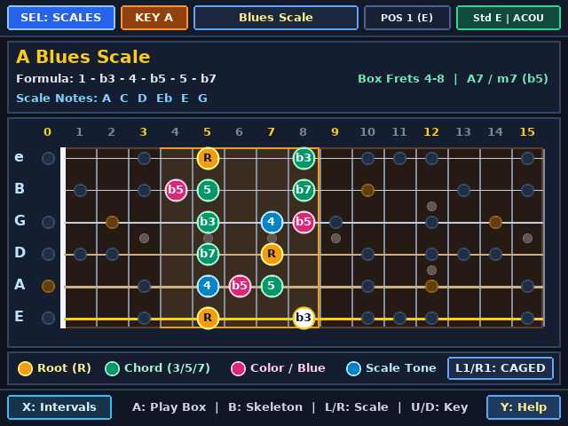
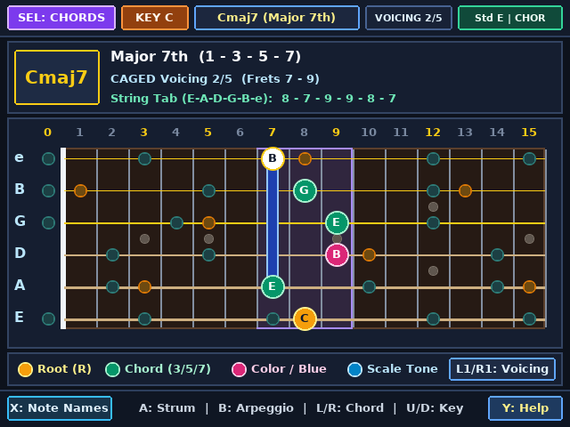
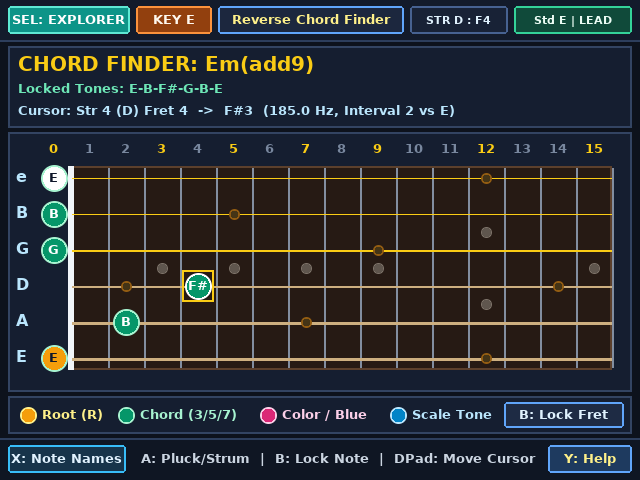
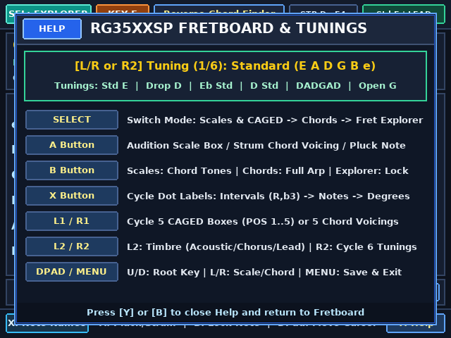

# Fretboard — 15-Fret CAGED Scale, Chord Voicing & Reverse Chord Finder (`RG35XXSP`)

An interactive 15-fret guitar neck encyclopedia, CAGED scale box visualizer, chord-voicing browser, and reverse chord finder written in pure C for the **Anbernic RG35XXSP** (`Allwinner H700`, `640×480` IPS display, 64-bit `aarch64` Linux framebuffer + `evdev` + ALSA) and **Linux Desktop (`x86_64` X11 + PulseAudio/ALSA)**.

---

## Screenshots

| Scales & CAGED Box View (`A Blues`, POS 1) | Chords & Arpeggios View (`Cmaj7`, Voicing 2) |
| :---: | :---: |
|  |  |

| Fret Explorer / Reverse Chord Finder (`Em(add9)`) | Help & 6-Tuning Selector (`Y` Button) |
| :---: | :---: |
|  |  |

---

## RG35XXSP Upgrades Over the PowKiddy V90 Version

1. **Upgraded 44.1 kHz Stereo Floating-Point Extended Karplus-Strong (EKS) Audio Engine**:
   - Replaces the V90's fixed-point 16-bit synthesizer with a 6-string 32-bit `float` Extended Karplus-Strong waveguide synthesizer featuring **first-order Thiran all-pass fractional delay interpolation** (eliminating high-fret pitch quantization up to Fret 15), **pick-position comb filtering**, **dual-biquad acoustic body resonance**, **3 selectable guitar timbres (`L2`)** (*Warm Acoustic*, *Chorus Electric*, and *Tube Overdrive*), and **stereo chorus / room ambience**.
2. **Asynchronous Background Audio Thread**:
   - All scale box runs, chord strums, arpeggio cascades, and single-string plucks are posted via a lock-free atomic ring buffer (`g_cmd_ring`) and synthesized entirely on a dedicated background audio thread, keeping the `640×480` UI thread at a rock-solid 60 FPS.
3. **Native `640×480` Resolution**:
   - Renders a full **15-fret rosewood fingerboard (`Frets 0–15`)** with pearloid inlays (`3, 5, 7, 9, 12, 15`), string gauge shading, and a dedicated upper-right theory & interval spelling card.
   - Displays both the active chord voicing (`F1..F4` fingerings or note names) and the full-neck underlying arpeggio tones simultaneously in **Chords & Arpeggios** mode.
   - Supports **6 guitar tunings (`R2` or inside `Y` Help)**: *Standard (`E A D G B e`)*, *Drop D (`D A D G B e`)*, *Eb Standard*, *D Standard*, *DADGAD*, and *Open G (`D G D G B D`)*.
4. **Native RG35XXSP Hardware Controls + Desktop Keyboard Parity**:
   - Maps all RG35XXSP `evdev` buttons (`A=304`, `B=305`, `Y=306`, `X=307`, `L1=308`, `R1=309`, `SELECT=310`, `START=311`, `L2=312`, `R2=313`, `MENU=316`) and matching desktop X11 keys (`A`, `B`, `X`, `Y`, `L`/`R`, `1`/`2`, `Tab`, `Enter`, and cursor keys).

---

## Controls

| RG35XXSP Button | Desktop X11 Key | Scales & CAGED (`MODE_SCALES`) | Chords & Arps (`MODE_CHORDS`) | Fret Explorer (`MODE_EXPLORER`) |
| :--- | :--- | :--- | :--- | :--- |
| **`SELECT`** | `Tab` / `BackSpace` | Switch to **Chords & Arpeggios** | Switch to **Fret Explorer** | Switch to **Scales & CAGED** |
| **`A`** | `A` / `Space` | **Play Ascending Scale Box** | **Strum Active Chord Voicing** | **Pluck Cursor Note / Strum Locked** |
| **`B`** | `B` | Toggle **Chord Tones (`1-3-5-7`)** | Toggle **Full-Neck Arpeggio** | **Lock / Unlock Note** on String |
| **`X`** | `X` | Cycle Dot Labels: `Intervals` $\rightarrow$ `Notes` $\rightarrow$ `Degrees` | Cycle Dot Labels (`Intervals` / `Notes` / `Fingers`) | Cycle Dot Labels (`Intervals` / `Notes` / `Degrees`) |
| **`Y`** | `Y` / `H` | Open / Close **Help & Tunings** | Open / Close **Help & Tunings** | Open / Close **Help & Tunings** |
| **`L1 / R1`** | `L` / `R` (or `[` / `]`) | Cycle **5 CAGED Boxes** (`ALL`, `POS 1..5`) | Cycle **5 CAGED Chord Voicings** | Jump Cursor `-3` / `+3` Frets |
| **`L2 / R2`** | `1` / `2` | `L2`: **Timbre** \| `R2`: **Guitar Tuning** | `L2`: **Timbre** \| `R2`: **Guitar Tuning** | `L2`: **Timbre** \| `R2`: **Guitar Tuning** |
| **`DPAD UP / DOWN`** | `Up` / `Down` | Transpose **Root Key** (`C` $\dots$ `B`) | Transpose **Root Key** (`C` $\dots$ `B`) | Move Cursor Across **6 Strings** |
| **`DPAD LEFT / RIGHT`** | `Left` / `Right` | Cycle **10 Guitar Scales** | Cycle **8 Chord Qualities** | Move Cursor Across **Frets `0–15`** |
| **`START` / `MENU`** | `Enter` / `Q` / `Esc` | Save State & **Exit** | Save State & **Exit** | Save State & **Exit** |

---

## Building & Running

```bash
# Build both RG35XXSP aarch64 binary (fretboard) and Linux x86_64 binary (fretboard_linux)
make

# Run natively on Linux desktop (640x480 X11 window + background audio synth)
./fretboard_linux

# Build the ready-to-copy SD card PortMaster package in sdcard_package/
make package
```
