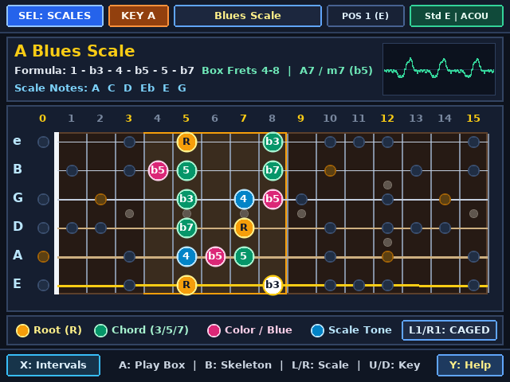
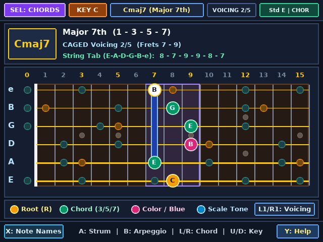
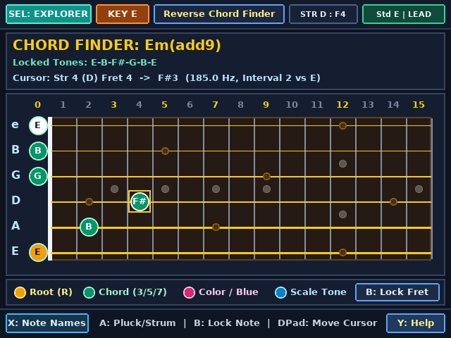
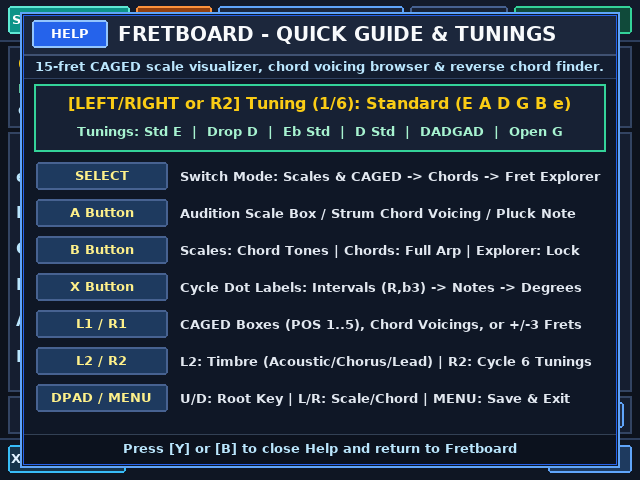

# Anbernic RG 35xxSP Fretboard — 15-Fret CAGED Scales, Chords & Reverse Finder (`640x480`)

An interactive **15-fret guitar neck encyclopedia, 5-position CAGED scale box visualizer, chord-voicing browser, and reverse chord finder** built in pure C for the **Anbernic RG 35xxSP** (Allwinner H700 `aarch64`, `640x480` IPS display) and **Linux Desktop (`x86_64` X11)**.

---

## Screenshots

| Scales & CAGED Box View (`A Blues`, POS 1) | Chords & Arpeggios View (`Cmaj7`, Voicing 2) |
| :---: | :---: |
|  |  |

| Fret Explorer / Reverse Chord Finder (`Em(add9)`) | Quick Guide & 6-Tuning Selector (`Y`) |
| :---: | :---: |
|  |  |

---

## Key Features

1. **44.1 kHz Stereo SoundFont 2 + Extended Karplus-Strong (EKS) Background Audio Engine**:
   - Loads **`GeneralUser-GS.sf2`** (or `pocketband.sf2`) automatically via `../rg35xxsp_sf2.h` with stereo room reverb, falling back seamlessly to a 6-string floating-point **Extended Karplus-Strong** waveguide guitar synthesizer with dual-biquad acoustic body resonance.
   - Supports **3 selectable guitar timbres (`L2`)**: *Acoustic Dreadnought*, *Chorus Electric*, and *Warm Overdrive Lead*.
   - All scale box runs, chord strums, arpeggio cascades, and single-string plucks run asynchronously on a **dedicated background audio thread** via a lock-free atomic ring buffer (`g_cmd_ring`), keeping the UI at a steady 60 FPS.
2. **Native `640x480` Full 15-Fret Fingerboard & 3 Modes (`SELECT`)**:
   - **Scales & CAGED**: 10 guitar scales across all 12 root keys with `ALL` and `POS 1..5` CAGED box frames plus optional chord-tone skeleton (`B`).
   - **Chords & Arpeggios**: 8 chord qualities with 5 movable CAGED voicings (`L1`/`R1`) overlaid on the optional full-neck arpeggio (`B`).
   - **Fret Explorer (Reverse Chord Finder)**: Navigate any string and fret (`0-15`), lock notes with **`B`**, and identify the resulting chord name and intervals live.
3. **6 Alternate Guitar Tunings (`R2` or inside `Y` Help)**:
   - *Standard (`E A D G B e`)*, *Drop D (`D A D G B e`)*, *Eb Standard*, *D Standard*, *DADGAD*, and *Open G (`D G D G B D`)*.

---

## Controls

| RG 35xxSP Button | Desktop X11 Key (`fretboard_linux`) | Scales & CAGED | Chords & Arps | Fret Explorer |
| :--- | :--- | :--- | :--- | :--- |
| **`SELECT`** | `Tab` | Switch to **Chords & Arpeggios** | Switch to **Fret Explorer** | Switch to **Scales & CAGED** |
| **`A`** | `A`, `Space`, `Z`, or `Alt` | **Play Ascending Scale Box** | **Strum Active Chord Voicing** | **Pluck Cursor Note / Strum Locked** |
| **`B`** | `B`, `Backspace`, or `Ctrl` | Toggle **Chord Tones (`1-3-5-7`)** | Toggle **Full-Neck Arpeggio** | **Lock / Unlock Note** on String |
| **`X`** | `X` | Cycle Labels: `Intervals` -> `Notes` -> `Degrees` | Cycle Labels (`Intervals` / `Notes` / `Degrees`) | Cycle Labels (`Intervals` / `Notes` / `Degrees`) |
| **`L1 / R1`** | `L`/`Q`/`[`/`PgUp` and `R`/`E`/`]`/`PgDn` | Cycle **5 CAGED Boxes** (`ALL`, `POS 1..5`) | Cycle **5 CAGED Chord Voicings** | Jump Cursor `-3` / `+3` Frets |
| **`L2 / R2`** | `1` / `2` | `L2`: **Timbre** \| `R2`: **Guitar Tuning** | `L2`: **Timbre** \| `R2`: **Guitar Tuning** | `L2`: **Timbre** \| `R2`: **Guitar Tuning** |
| **`D-Pad UP / DOWN`** | `Up` / `Down Arrow` | Transpose **Root Key** (`C`..`B`) | Transpose **Root Key** (`C`..`B`) | Move Cursor Across **6 Strings** |
| **`D-Pad LEFT / RIGHT`** | `Left` / `Right Arrow` | Cycle **10 Guitar Scales** | Cycle **8 Chord Qualities** | Move Cursor Across **Frets `0-15`** |
| **`Y`** | `Y` | Toggle **Quick Guide & Tunings** (`L/R` or `R2` selects tuning) | Toggle **Quick Guide & Tunings** | Toggle **Quick Guide & Tunings** |
| **`MENU (`M`)`** | `Esc` | Save State & **Exit** | Save State & **Exit** | Save State & **Exit** |

---

## Building & Running

```bash
cd fretboard
make all
```
- **RG 35xxSP Binary & SD Card Package**: `sdcard_package/roms/ports/Fretboard.sh` and `sdcard_package/roms/ports/fretboard/fretboard`
- **SoundFont (Recommended)**: Copy `../soundfonts/GeneralUser-GS.sf2` to `/userdata/roms/ports/soundfonts/GeneralUser-GS.sf2` on your SD card.
- **Linux Desktop X11 Simulator**: `./fretboard_linux` (or `make run-linux`)
