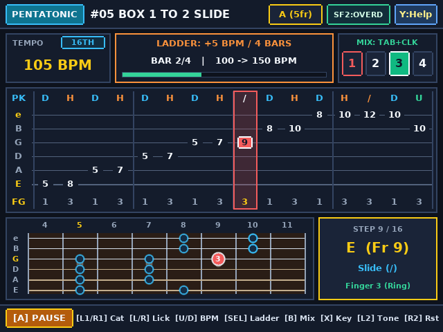
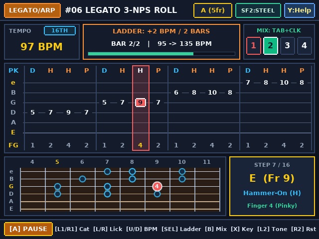
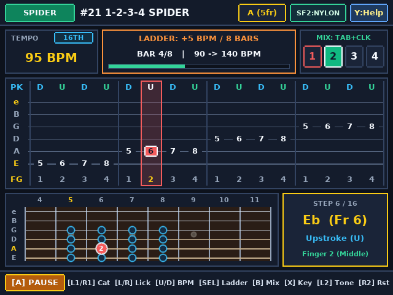
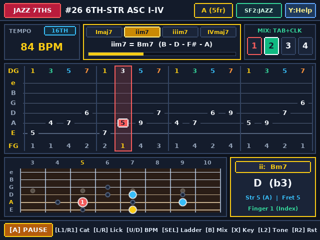
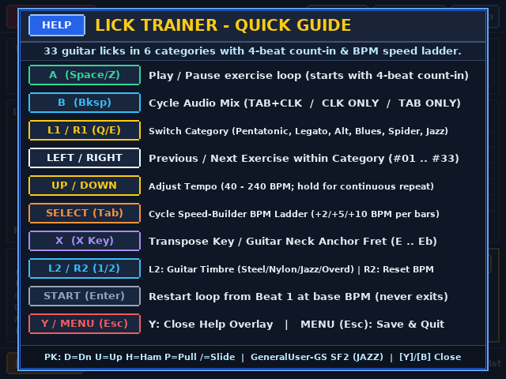

# Anbernic RG 35xxSP Guitar Speed-Builder & Lick Coach (`licktrainer`, `640×480`)

A native **`640×480`** 32-bit XRGB8888 **6-String Guitar Tab Player, Live Fretboard Position Coach, Diatonic Jazz 7th Arpeggio Trainer, and Automated BPM Speed-Builder** built for the **Anbernic RG 35xxSP** (Allwinner H700 64-bit ARM Cortex-A53) and **Linux Desktop (`x86_64` X11)**.

---

## Screenshots

### 1. Pentatonic Licks (`#05 BOX 1 TO 2 SLIDE`, `SF2:OVERD`)


### 2. Legato & Arpeggios (`#06 LEGATO 3-NPS ROLL`, `SF2:STEEL`)


### 3. Warmup & Spider Drills (`#21 1-2-3-4 SPIDER`, `SF2:NYLON`)


### 4. Jazz 7th Chord Arpeggios (`#26 6TH-STR ASC I-IV`, `SF2:JAZZ`)


### 5. Interactive Controls & Practice Guide (`Y`)


---

## Features

1. **All 33 Curated Exercises Across 6 Categories (`L1` / `R1` Category, `LEFT` / `RIGHT` Lick)**:
   - **`PENTATONIC` (`#01`–`#05`)**: *Gilbert 4-Note Seq*, *Eric Johnson 5s*, *Pentatonic Threes (12/8)*, *Wide String Skip*, *Box 1 to 2 Slide*.
   - **`LEGATO/ARP` (`#06`–`#10`)**: *Legato 3-NPS Roll*, *Minor Triad Arp*, *Min7 Skipped Arp*, *Dim7 Symmetry Arp*, *5-Str Sweep Shape*.
   - **`ALT PICK` (`#11`–`#15`)**: *Gilbert 3-NPS Cell*, *Neoclassic Pedal*, *Diatonic 4-Note*, *Di Meola Syncopa*, *Cross-String Jump*.
   - **`BLUES/ROCK` (`#16`–`#20`)**: *BB & Albert Turn*, *SRV Texas Shuffle*, *Dorian Mixo Run*, *Hendrix Chord Embl*, *Blues b5 Cascade*.
   - **`SPIDER` (`#21`–`#25`)**: *1-2-3-4 Spider*, *1-3-2-4 Permute*, *Skipping Spider*, *Diagonal Spider*, *4-3-2-1 Pinky Work*.
   - **`JAZZ 7THS` (`#26`–`#33`)**: Complete diatonic `1–3–5–7` 7th-chord arpeggio studies (*6th-Str Asc I-IV / V-I*, *Voice-Led Alt I-IV / V-I*, *Upper-Reg 7ths I-IV / V-I*, *Cycle of 4ths Pt.1 / Pt.2*) with 4-chord progression header, spelled chord tones, chord-tone degree (`DG`) row, and live active-beat 4-note chord highlight on the fretboard.
2. **Automated Speed-Builder BPM Ladder (`SELECT`) & 4-Beat Count-In**:
   - Cycle between `OFF (STATIC BPM)`, `+2 BPM / 2 BARS`, `+5 BPM / 4 BARS`, `+5 BPM / 8 BARS`, and `+10 BPM / 4 BARS` with live progress bar and automatic measure-boundary tempo stepping.
3. **Studio Background-Thread Audio (`GeneralUser-GS.sf2` + Enhanced EKS Fallback)**:
   - Runs 100% of synthesis, count-in, metronome clicks, and step sequencing on a dedicated background audio thread (`rg35xxsp_sf2.h`).
   - Supports 4 SoundFont guitar timbres (**Steel Acoustic**, **Nylon Classical**, **Clean Jazz**, **Overdrive Electric**) with articulation-aware legato velocity + GM woodblock/rimshot clicks and Schroeder stereo room reverb, plus a 44.1 kHz floating-point **Extended Karplus-Strong (EKS)** fallback.

---

## Controls (`rg35xxsp_input.h`)

| Action | Anbernic RG 35xxSP Button | Linux Desktop Key (`licktrainer_linux`) |
| :--- | :--- | :--- |
| **Play / Pause Loop (with 4-beat count-in)** | **A** | `A`, `Space`, or `Z` |
| **Cycle Audio Mix (`TAB+CLK` / `CLK ONLY` / `TAB ONLY`)** | **B** | `B` or `Backspace` |
| **Cycle Speed-Builder BPM Ladder** | **SELECT** | `Tab` |
| **Transpose Musical Key / Neck Fret (`E`..`Eb`)** | **X** | `X` |
| **Previous / Next Category (`1..6`)** | **L1 / R1** | `L`/`Q`/`[`/`PgUp` and `R`/`E`/`]`/`PgDn` |
| **Previous / Next Lick within Category** | **D-Pad LEFT / RIGHT** | `Left` / `Right` Arrows |
| **Adjust Tempo (`40–240 BPM`, hold repeat)** | **D-Pad UP / DOWN** | `Up` / `Down` Arrows |
| **Cycle Guitar Timbre (`Steel`/`Nylon`/`Jazz`/`Overd`)** | **L2** | `1` |
| **Reset BPM to Lick Default & Reset Ladder** | **R2** | `2` |
| **Restart Loop from Beat 1 at Base BPM** | **START** | `Enter` |
| **Toggle Help & Practice Guide Overlay** | **Y** | `Y` |
| **Save `.licktrainer_rg35xxsp.cfg` & Quit** | **MENU** | `Esc` |

---

## Building & Packaging

```bash
cd licktrainer
make clean all test screenshots
```

- **RG 35xxSP SD Card Package**: `sdcard_package/roms/ports/LickTrainer.sh` and `sdcard_package/roms/ports/licktrainer/licktrainer`
- **SoundFont (Recommended)**: Copy `../soundfonts/GeneralUser-GS.sf2` to `/userdata/roms/ports/soundfonts/GeneralUser-GS.sf2` on your SD card.
- **Linux Desktop X11 Simulator**: `./licktrainer_linux` (or `make run-linux`)
- **Automated Music-Theory & Biomechanics Verification (all 33 studies)**: `./licktrainer_linux --verify`
