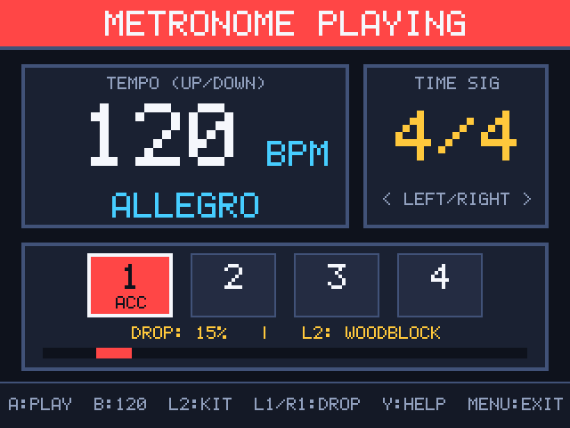
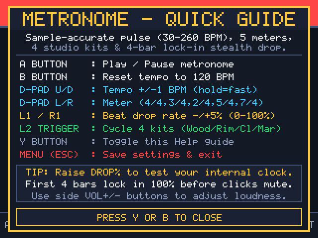

# Anbernic RG 35xxSP Metronome (`640x480`)

A sample-accurate studio metronome built for the **Anbernic RG 35xxSP** clamshell handheld running **Knulli (Scarab / Batocera)** (Allwinner H700 `aarch64`, **640x480** IPS display), plus a native **x86_64 Linux (X11)** target for desktop testing.

| Main Metronome View | Quick Guide & Controls (`Y`) |
| :---: | :---: |
|  |  |

## Features
- **Sample-Accurate 44.1 kHz Background Audio Clock**: Computes beat boundaries directly on the dedicated background audio thread (zero UI-thread jitter), using SDL2 Audio on Knulli (with automatic ALSA `libasound.so.2` fallback) and PulseAudio on Linux desktop.
- **4 Studio Click Kits (`L2`)**: Cycle between **`WOODBLOCK`**, **`DRUM RIM`**, **`CLASSIC`**, and **`MARIMBA`** using SoundFont 2 (`GeneralUser-GS.sf2` / `pocketband.sf2` via `../rg35xxsp_sf2.h`) with room reverb and crisp studio DSP fallbacks.
- **5 Time Signatures**: Cycle between **`4/4`**, **`3/4`**, **`2/4`**, **`5/4`**, and **`7/4`** time with Beat 1 red `ACC` accent flashes, green regular beat boxes, classical tempo markings (`GRAVE` to `PRESTISSIMO`), and a smooth pendulum phase bar.
- **4-Bar Lock-In Stealth Beat Drop (`L1` / `R1`)**: Adjust click drop probability from **`0%` to `100%`** in `5%` steps. The first **4 measures** always play 100% of clicks so you can lock into the groove before clicks randomly drop out to test your internal clock.
- **Continuous Tempo Hold (`30-260 BPM`)**: Tap D-Pad `UP` / `DOWN` for `+/-1 BPM` precision, or hold for smooth accelerating continuous sweep.
- **Persistent Settings**: Automatically saves BPM, time signature, and click kit to `/userdata/system/.metronome.cfg` on Knulli (or `~/.metronome.cfg` on Linux).

---

## Controls (Anbernic RG 35xxSP & Linux Desktop)

| Action | Anbernic RG 35xxSP Button | Linux Desktop Key (`metronome_linux`) |
| :--- | :--- | :--- |
| **Play / Pause** | **A** | `A`, `Space`, `Z`, or `Alt` |
| **Reset Tempo to 120 BPM** | **B** | `B`, `Backspace`, or `Ctrl` |
| **Increase / Decrease Tempo (`+/-1 BPM`, hold for continuous)** | **D-Pad UP** / **DOWN** | `Up Arrow` / `Down Arrow` |
| **Cycle Time Signature (`4/4`, `3/4`, `2/4`, `5/4`, `7/4`)** | **D-Pad LEFT** / **RIGHT** | `Left Arrow` / `Right Arrow` |
| **Adjust Stealth Beat Drop (`-5%` / `+5%`, `0%-100%`)** | **L1** / **R1** | `L` / `Q` / `[` / `PgUp` and `R` / `E` / `]` / `PgDn` |
| **Cycle 4 Studio Click Kits (`Woodblock`, `Drum Rim`, `Classic`, `Marimba`)** | **L2** | `1` |
| **Toggle Quick Guide & Controls Overlay** | **Y** | `Y` |
| **Save Settings & Exit** | **MENU (`M`)** | `Esc` |

Use the RG 35xxSP's physical side volume buttons (`VOL+` / `VOL-`) to adjust speaker or headphone loudness.

---

## Copying to Your Anbernic RG 35xxSP (Knulli SD Card)

Run `make` (or `make package`) to build both targets and populate `sdcard_package/`:
```bash
cd metronome
make all
```

Copy the contents of `sdcard_package/roms/ports/` to `/userdata/roms/ports/` on your Knulli SD card:
- `sdcard_package/roms/ports/Metronome.sh` -> `/userdata/roms/ports/Metronome.sh`
- `sdcard_package/roms/ports/metronome/` -> `/userdata/roms/ports/metronome/`

For upgraded SoundFont studio kits, copy `../soundfonts/GeneralUser-GS.sf2` to `/userdata/roms/ports/soundfonts/GeneralUser-GS.sf2`.

Then in Knulli (EmulationStation), press **START -> Game Settings -> Update Games Lists**, open **Ports**, and launch **Metronome**.

---

## Building & Running on Linux Desktop (`x86_64`)

```bash
cd metronome
make linux       # builds ./metronome_linux
make run-linux   # builds and opens the 640x480 X11 window
```
