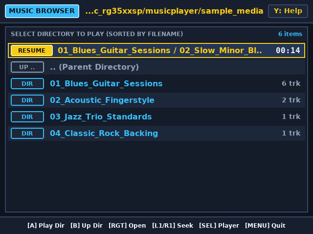
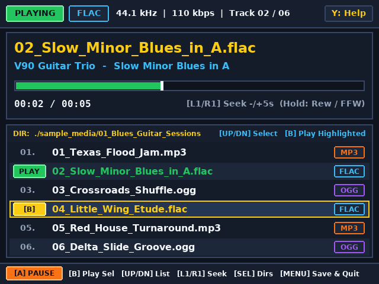
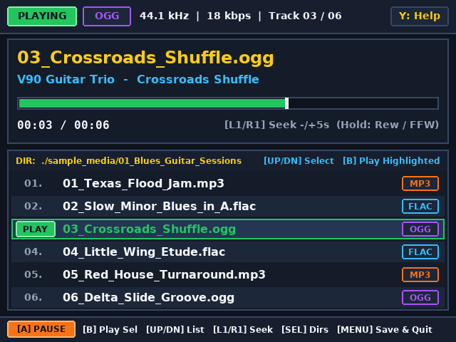
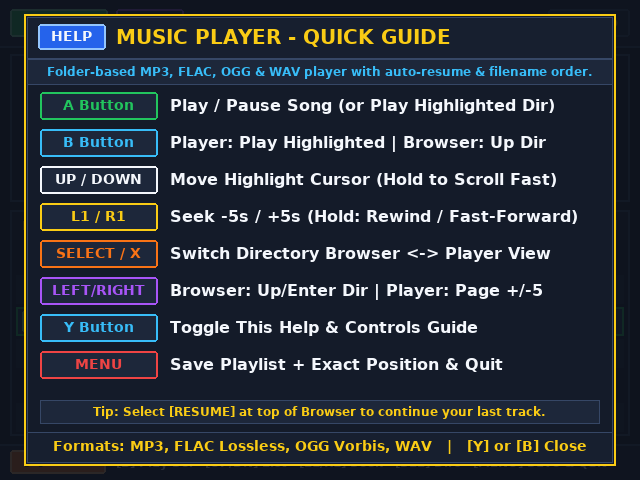

# Anbernic RG 35xxSP Directory Music Player (`musicplayer`, `640×480`)

A fast, distraction-free native **`640×480`** **Directory Music Player (`MP3` / `FLAC` / `OGG` / `WAV`)** ported to the **Anbernic RG 35xxSP** (Allwinner H700 64-bit quad-core ARM Cortex-A53) and **Linux Desktop (`x86_64` X11)** with **zero third-party `.so` dependencies**.

---

## Screenshots

| Directory Browser (with `[RESUME]`) | Now Playing (`FLAC`) & Playlist | Ogg Vorbis (`OGG`) Playback | Controls & Guide (`Y`) |
| :---: | :---: | :---: | :---: |
|  |  |  |  |

---

## Key Features

1. **Zero External `.so` Dependencies (100% Statically Compiled Audio Decoders)**:
   - **MP3 (`.mp3`)**: Statically compiled `../third_party/dr_mp3.h` with built-in ID3v1 & ID3v2 (`TIT2`/`TPE1`) metadata extraction.
   - **FLAC (`.flac`)**: Statically compiled `../third_party/dr_flac.h` with Vorbis comment metadata (`TITLE`/`ARTIST`).
   - **Ogg Vorbis (`.ogg`)**: Statically compiled `../third_party/stb_vorbis.c` with Vorbis comment metadata.
   - **WAV (`.wav`)**: Built-in 8/16-bit PCM RIFF/WAVE reader.
2. **Dedicated Background Decoder Thread & Clean Linear-Interpolated Resampling**:
   - All decoding, seeking, and resampling to `44.1 kHz` stereo 16-bit PCM run asynchronously on a dedicated background thread feeding a lock-free 64K-frame ring buffer.
   - Audio output uses `dlopen("libSDL2-2.0.so.0")` with automatic `dlopen("libasound.so.2")` fallback on RG 35xxSP (`libpulse-simple.so.0` / `libasound.so.2` on desktop), keeping the `640×480` UI smooth and stutter-free.
3. **Directory Browser with `[RESUME]` at the Top**:
   - Opens to `/userdata/music`, `/userdata/media`, or `./sample_media`.
   - Displays a highlighted **`[RESUME] <Dir> / <Track> (MM:SS)`** row at index 0 whenever a saved session exists.
   - Selecting any directory with **`A`** loads all supported audio tracks sorted in **filename order** (`strcasecmp`) and starts playback immediately.
4. **Distraction-Free Now Playing + Interactive Playlist & Global Hold-to-Seek**:
   - Clean `640×480` layout (no spectrum analyzer) showing track title, format badge (`MP3`/`FLAC`/`OGG`/`WAV`), sample rate, bitrate, progress bar with `MM:SS / MM:SS`, and scrollable interactive playlist (`UP`/`DOWN` highlights, **`B`** plays highlighted song, **`A`** toggles Play/Pause).
   - **`L1` / `R1`** seek `-5s` / `+5s` on tap and accelerate into continuous Rewind / Fast-Forward while held — working seamlessly in **both** Browser and Player views.
   - Pressing **`MENU`** saves the active directory, playlist, track index, and exact `position_ms` to `.musicplayer_rg35xxsp.cfg` before exiting cleanly.

---

## Controls

| RG 35xxSP Button | Linux Desktop (`musicplayer_linux`) | Directory Browser Action | Now Playing / Playlist Action |
| :--- | :--- | :--- | :--- |
| **A** | `A`, `Space`, or `Z` | **Resume** saved session or **Play Directory** | **Play / Pause** current song |
| **B** | `B` or `Backspace` | Go up to **Parent Directory (`..`)** | **Play Highlighted Song** in playlist |
| **UP / DOWN** | `Up` / `Down Arrow` | Move cursor (hold to scroll quickly) | Highlight song in playlist (hold to scroll) |
| **LEFT / RIGHT** | `Left` / `Right Arrow` | Parent folder (`..`) / Enter subfolder | Page Up / Page Down 5 tracks |
| **L1 / R1** | `L`/`R`, `Q`/`E`, `[`/`]`, `PgUp`/`PgDn` | **Seek -5s / +5s** (Hold: Rew / FFW) | **Seek -5s / +5s** (Hold: Rew / FFW) |
| **SELECT** (or **X**) | `Tab` (or `X`) | Switch to **Now Playing / Playlist** | Switch to **Directory Browser** |
| **Y** | `Y` | Toggle **Help Overlay** | Toggle **Help Overlay** |
| **MENU** | `Esc` | **Save Playlist + Position & Quit** | **Save Playlist + Position & Quit** |

---

## Building & Verification

```bash
cd musicplayer
make all
make test
```

- **RG 35xxSP Binary & SD Card Package**: `sdcard_package/roms/ports/MusicPlayer.sh` and `sdcard_package/roms/ports/musicplayer/musicplayer`
- **Linux Desktop X11 Simulator**: `./musicplayer_linux` (or `make run-linux`)
- **Automated Verification**: `./musicplayer_linux --verify ./sample_media/01_Blues_Guitar_Sessions`
- **Automated Screenshots**: `./musicplayer_linux --screenshot /tmp ./sample_media`
