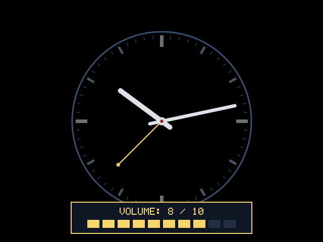
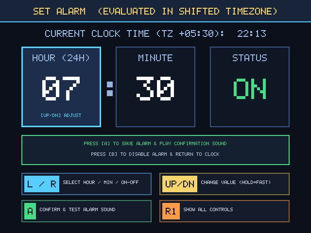
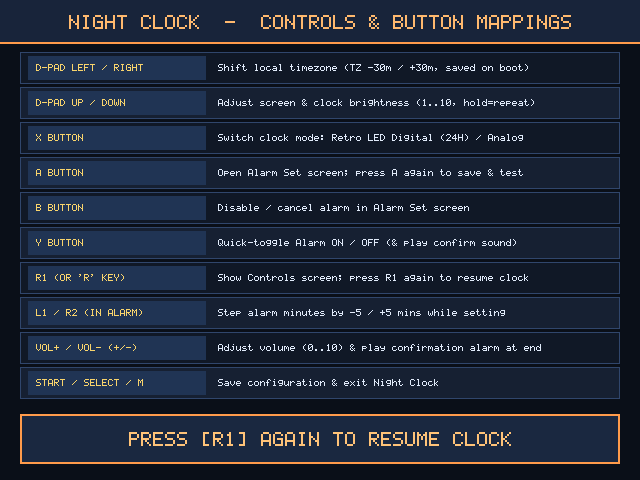

# Anbernic RG 35xxSP Night Clock (`640×480`)

A single-screen bedside and desk clock for the **Anbernic RG 35xxSP** (Allwinner H700 `aarch64`, `640×480` 4:3 IPS display), plus a native **x86_64 Linux (X11)** target for desktop testing.

---

## Screenshots

### 1. Retro LED Digital Clock (24H)


### 2. Minimal Analog Clock & Volume Indicator


### 3. Single-Screen Alarm Editor (in Shifted Timezone)


### 4. Right Shoulder (`R1`) Controls & Button Mappings Screen


---

## Features

1. **App-Local Timezone Shift (`LEFT` / `RIGHT` in 30-Minute Steps)**:
   - Pressing **D-Pad `LEFT`** or **`RIGHT`** shifts the clock's displayed time in **30-minute increments** (`-24:00` to `+24:00`) relative to the device's clock (`TZ +00:00`, `TZ +05:30`, `TZ -03:30`, etc.).
   - The shift applies **only** to `night_clock` (the OS/device timezone and RTC are never modified) and is persisted across reboots in `.night_clock.cfg`.

2. **24-Hour Retro LED Dot-Matrix Digital & Minimalist Analog Display (`X` Key)**:
   - **Digital Mode (Default)**: Displays **24-hour time** (`00:00` – `23:59`, `HH:MM` without seconds) using a custom **`7×11` Retro LED Dot-Matrix Bit-Font** (`105×165 px` per digit) with a constant (non-blinking) `:` separator, plus a subtle metadata strip underneath (`24H | TZ +/-HH:MM | ALARM ...`).
   - **Analog Mode (`X` Key)**: Switches to a high-contrast, minimalist analog clock dial (`radius = 178 px`) with bold Hour and Minute batons (no second hand) rendered using anti-aliased distance-field circles and lines, plus a muted-gold alarm indicator needle when the alarm is armed.
   - **10-Minute IPS Anti-Burn-In Orbit**: Every **10 minutes**, the clock center smoothly glides to the next position on a bounded 9-point orbit around the `640×480` screen center (`±38 px` horizontal, `±26 px` vertical) so no static high-contrast pixels remain fixed overnight.

3. **Brightness (`UP` / `DOWN`) & Volume Level Indicator (`VOL+` / `VOL-`)**:
   - **Brightness (`UP` / `DOWN`)**: Steps brightness across levels `1..10` (with continuous hold auto-repeat), updating both the hardware backlight (`/sys/class/disp/disp/attr/lcdbl` and `/sys/class/backlight/*/brightness`) and a software RGB dimming curve (`22%..100%`).
   - **Volume Level & Confirmation (`VOL+` / `VOL-`)**: Pressing or holding **`VOL+`** / **`VOL-`** displays an on-screen **Volume** indicator (`0 / 10` .. `10 / 10` with a 10-segment bar) in real time and, when released at the end of the adjustment, plays the confirmation alarm tone at that selected volume.

4. **Single-Screen Alarm Editor (`A` Key) & Controls View (`R1`)**:
   - **Set Alarm (`A` Key)**:
     - Pressing **`A`** opens the interactive **Alarm Set** view on the screen (`HOUR`, `MINUTE`, `ON/OFF` in the **shifted timezone**).
     - Pressing **`A`** again saves and arms the alarm, plays a **4-pulse dual-harmonic confirmation alarm sound** (~1.6 seconds) at the current volume, and resumes the clock. Pressing **`B`** disables the alarm and returns to the clock.
   - **Controls / Help (`R1`)**:
     - Pressing **`R1`** (Right Shoulder) shows the **Controls & Button Mappings** view on the screen; pressing **`R1`** again resumes the clock.

---

## Controls

| Action | Anbernic RG 35xxSP Button | Linux Desktop Key (`night_clock_linux`) |
| :--- | :--- | :--- |
| **Shift Local Timezone (`-30m` / `+30m`, hold for continuous)** | **D-Pad LEFT** / **RIGHT** | `Left Arrow` / `Right Arrow` |
| **Adjust Brightness (`1..10`, hold for continuous)** | **D-Pad UP** / **DOWN** | `Up Arrow` / `Down Arrow` |
| **Toggle Digital (Retro LED 24H) ↔ Analog Clock** | **X** | `X` (or `Left Shift`) |
| **Open Alarm Set Screen / Confirm & Play Test Alarm** | **A** | `A` (or `Space` / `Z` / `Left Alt`) |
| **Cancel / Turn Off Alarm (in Alarm Set Screen)** | **B** | `B` (or `Backspace` / `Left Ctrl`) |
| **Quick-Toggle Alarm ON / OFF** | **Y** | `Y` |
| **Show Controls Screen / Resume Clock** | **R1 (Right Shoulder)** | `R`, `E`, `]`, or `Page Up` |
| **Fast Alarm Minute Step (`-5m` / `+5m` in Alarm Set Screen)** | **L1 / L2** (`-5m`) and **R2** (`+5m`) | `L` / `Q` / `[` / `1` (`-5m`) and `2` (`+5m`) |
| **Volume Up / Down (plays confirmation alarm at end)** | **VOL+** (`115`) / **VOL-** (`114`) | `+` / `=` and `-` / `_` |
| **Save Configuration & Exit** | **START**, **SELECT**, or **MENU (`M`)** | `Enter`, `Tab`, `M`, or `ESC` |

---

## Building & Running

### 1. Build for Anbernic RG 35xxSP (`aarch64`) & SD Card Package
```bash
cd night_clock
make
```
This builds `night_clock` (`aarch64`) and populates `sdcard_package/`:
- `sdcard_package/roms/ports/Night_Clock.sh`
- `sdcard_package/roms/ports/night_clock/night_clock`
- `sdcard_package/roms/ports/night_clock/night_clock.png`

### 2. Build & Run on Linux Desktop (`x86_64` X11 Simulator)
```bash
cd night_clock
make linux
make run-linux
```
