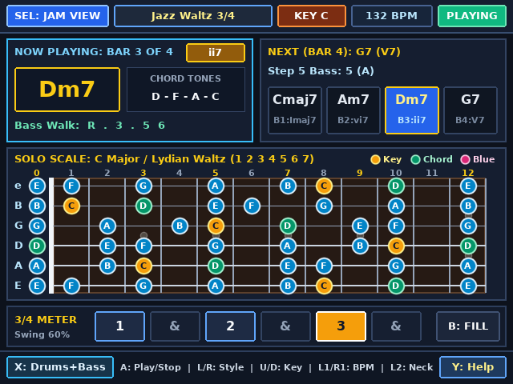
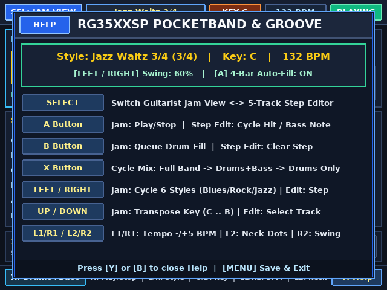

# PocketBand — Multi-Track Drum Machine, Bassline & Backing Band (`RG35XXSP`)

A 5-track drum machine, walking bassline sequencer, stereo chord-comping backing band, and 12-fret guitar soloing map written in pure C for the **Anbernic RG35XXSP** (`Allwinner H700`, `640×480` IPS display, 64-bit `aarch64` Linux framebuffer + `evdev` + ALSA) and **Linux Desktop (`x86_64` X11 + PulseAudio/ALSA)**.

Plug the RG35XXSP's 3.5mm audio output into your guitar amp's AUX input (or headphones) and jam immediately over **Blues, Rock, and Jazz** backing tracks in **`4/4`** and **`3/4`**.

---

## Screenshots

| Guitarist Jam View (`Blues Shuffle 4/4`, Intervals) | 5-Track Step & Bassline Editor (`Classic Rock 4/4`) |
| :---: | :---: |
|  |  |

| `3/4` Waltz Jam View (`Jazz Waltz 3/4`, Note Names) | Help & Groove Modal (`Y` Button) |
| :---: | :---: |
|  |  |

---

## RG35XXSP Upgrades Over the PowKiddy V90 Version

1. **Upgraded 44.1 kHz Stereo Floating-Point Multi-Track Backing Band Engine**:
   - Replaces the V90's fixed-point 16-bit mono synth with a 5-voice 32-bit `float` stereo synthesizer:
     - **Analog-Modeled Kick Drum**: Exponential pitch sweep (`174 Hz` $\rightarrow$ `44 Hz`), beater transient click, and soft-clip saturation.
     - **Acoustic / 909 Snare Drum**: Dual resonant shell modes (`186 Hz` + `332 Hz`) plus a biquad bandpass snare-wire noise stage.
     - **6-Oscillator Metallic Cymbal / Hi-Hat / Jazz Ride Bank**: Inharmonic square-wave bank through a second-order high-pass filter with closed-hat choke.
     - **Resonant SVF Electric Bass Synthesizer**: Plucked sawtooth + sub-octave fundamental routed through a 2-pole State-Variable Low-Pass Filter with dynamic pluck-envelope cutoff modulation.
     - **4-Voice Stereo Rhythm Guitar / Rhodes Comping**: Staggered strum delays, stereo LFO chorus detuning, and panning across the stereo field.
2. **Asynchronous Background Audio Thread**:
   - All sequencer timing, voice triggering, floating-point synthesis, and stereo bus mixing run inside a dedicated background audio thread (`audio_thread_worker`) so the `640×480` UI thread never blocks or drops below 60 FPS.
3. **Native `640×480` IPS Display Layout**:
   - **Live Per-Track VU Meters (`KCK`, `SNR`, `HAT`, `BAS`, `CMP`)** and a chord progression & groove inspector card.
   - **12-Fret Rosewood Soloing Scale Map** with labeled anti-aliased dots that toggle between **Intervals (`R, b3, 4, b5, 5, b7`)** and **Note Names (`A, C, D, Eb, E, G`)** via **`L2`**.
   - **5-Track Step Editor (`SELECT`)** that displays both the scale degree (`R, 3, 5, 6, b7, 8`) and the live transposed note name (`E, B`, etc.) inside every bass step cell.
4. **Native RG35XXSP Hardware Controls + Desktop Keyboard Parity**:
   - Maps all RG35XXSP `evdev` buttons (`A=304`, `B=305`, `Y=306`, `X=307`, `L1=308`, `R1=309`, `SELECT=310`, `START=311`, `L2=312`, `R2=313`, `MENU=316`) and matching desktop X11 keys (`A`, `B`, `X`, `Y`, `L`/`R`, `1`/`2`, `Tab`, `Enter`, and cursor keys).

---

## Controls

| RG35XXSP Button | Desktop X11 Key | Guitarist Jam View (`VIEW_JAM`) | Step Editor View (`VIEW_STEP_EDITOR`) |
| :--- | :--- | :--- | :--- |
| **`SELECT`** | `Tab` / `BackSpace` | Switch to **5-Track Step Editor** | Switch back to **Guitarist Jam View** |
| **`A`** | `A` / `Space` | **Play / Stop** backing band | Cycle drum hit (`OFF`/`ON`/`ACC`) or bass note (`R,3,5,6,b7,8`) |
| **`B`** | `B` | **Queue Drum Fill** at end of current bar | Clear selected step (`OFF`) |
| **`X`** | `X` | **Cycle Backing Mix**: `Full Band` $\rightarrow$ `Drums+Bass` $\rightarrow$ `Drums Only` | **Cycle Backing Mix**: `Full Band` $\rightarrow$ `Drums+Bass` $\rightarrow$ `Drums Only` |
| **`Y`** | `Y` / `H` | Open / Close **Help & Groove Settings** | Open / Close **Help & Groove Settings** |
| **`L1 / R1`** | `L` / `R` (or `[` / `]`) | Adjust **Tempo** (`-5` / `+5` BPM, `45–220 BPM`) | Adjust **Tempo** (`-5` / `+5` BPM) |
| **`L2 / R2`** | `1` / `2` | `L2`: Toggle Fretboard **Intervals / Notes** \| `R2`: Cycle **Swing %** | `L2`: Toggle Fretboard **Intervals / Notes** \| `R2`: Cycle **Swing %** |
| **`DPAD LEFT / RIGHT`** | `Left` / `Right` | Cycle **6 Styles** (`Blues`, `Rock`, `Jazz` in `4/4` & `3/4`) | Move Step Cursor across `1 & 2 & 3 & [4 &]` |
| **`DPAD UP / DOWN`** | `Up` / `Down` | Transpose **Key** (`C`, `Db`, `D`, $\dots$, `B`) | Select Track (`KICK`, `SNARE`, `CL HAT`, `OP HAT`, `BASS`) |
| **`START` / `MENU`** | `Enter` / `Q` / `Esc` | Save State & **Exit** | Save State & **Exit** |

---

## Building & Running

```bash
# Build both RG35XXSP aarch64 binary (pocketband) and Linux x86_64 binary (pocketband_linux)
make

# Run natively on Linux desktop (640x480 X11 window + background audio synth)
./pocketband_linux

# Build the ready-to-copy SD card PortMaster package in sdcard_package/
make package
```
