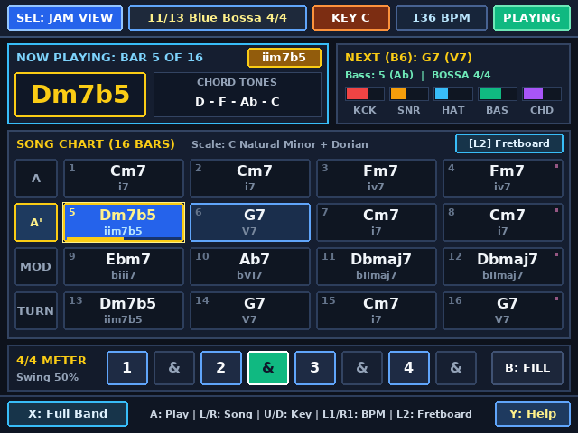
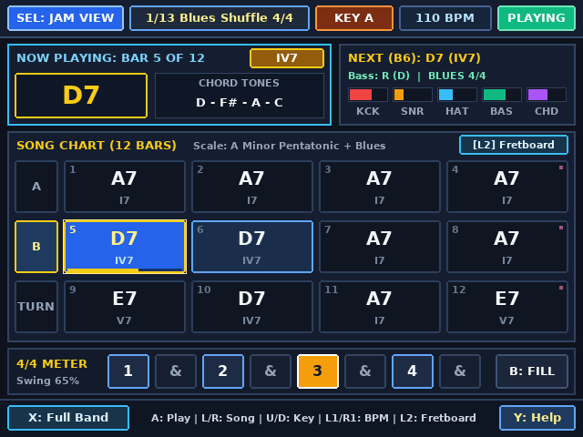
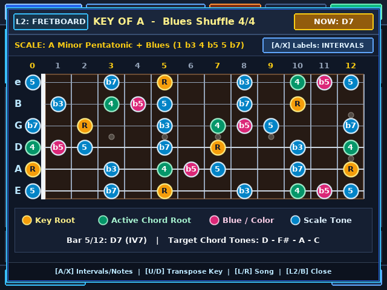
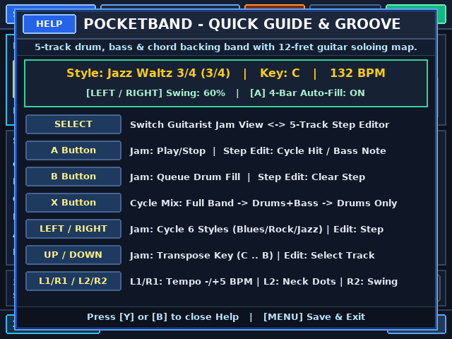
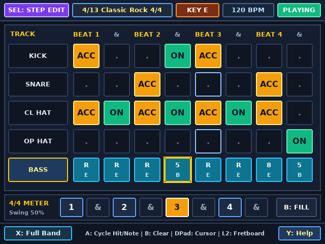

# Anbernic RG 35xxSP PocketBand — Drum Machine, Bassline & Backing Band (`640x480`)

A **5-track drum machine, walking bassline sequencer, stereo chord-comping backing band, full multi-bar Song Chart (8 / 12 / 16+ bars), and on-demand `L2` 12-fret guitar soloing map** built in pure C for the **Anbernic RG 35xxSP** (Allwinner H700 `aarch64`, `640x480` IPS display) and **Linux Desktop (`x86_64` X11)**.

All song structures live as editable plain-text `.song` files inside [`songs/`](songs/) — drop in your own custom `.song` files and PocketBand loads and cycles through all of them automatically on startup!

---

## Screenshots

| 16-Bar Song Chart (`Blue Bossa 4/4`) | 12-Bar Song Chart (`Blues Shuffle 4/4`) |
| :---: | :---: |
|  |  |

| On-Demand `[L2]` 12-Fret Soloing Map | Quick Guide, Song Structure & Famous Songs (`Y`) |
| :---: | :---: |
|  |  |

| 5-Track Drum & Bassline Step Editor (`SELECT`) |
| :---: |
|  |

---

## Included Disk Song Library (`songs/*.song`)

All 13 built-in song structures are loaded from disk on startup (`LEFT`/`RIGHT` cycles through every `.song` file in alphabetical order). Press **`Y`** on any song to see which famous songs follow that structure:

| File | Song | Bars | Meter | BPM | Famous Songs Using This Structure |
| :--- | :--- | :---: | :---: | :---: | :--- |
| `01_blues_shuffle.song` | Blues Shuffle 4/4 | 12 | 4/4 | 110 | *Sweet Home Chicago, Red House, Pride and Joy* |
| `02_slow_blues_waltz.song` | Slow Blues 3/4 | 12 | 3/4 | 86 | *Stormy Monday, Texas Flood, Since I've Been Loving You* |
| `03_minor_blues.song` | Minor Blues 4/4 | 12 | 4/4 | 90 | *The Thrill Is Gone, Black Magic Woman, Still Got the Blues* |
| `04_classic_rock.song` | Classic Rock 4/4 | 16 | 4/4 | 120 | *Sweet Home Alabama, Born to Be Wild, Fortunate Son* |
| `05_rock_ballad_waltz.song` | Rock Ballad 3/4 | 16 | 3/4 | 96 | *House of the Rising Sun, Nothing Else Matters* |
| `06_descending_rock.song` | Descending Rock | 16 | 4/4 | 92 | *Hotel California (Verse + Chorus)* |
| `07_canon_ballad.song` | Canon Ballad 4/4 | 16 | 4/4 | 100 | *Canon in D, Basket Case, Let It Be, Memories* |
| `08_fifties_soul.song` | 50s Soul 4/4 | 16 | 4/4 | 108 | *Stand By Me, Earth Angel, Unchained Melody* |
| `09_jazz_swing.song` | Jazz Swing 4/4 | 16 | 4/4 | 126 | *Fly Me to the Moon, Autumn Leaves, All the Things You Are* |
| `10_jazz_waltz.song` | Jazz Waltz 3/4 | 16 | 3/4 | 132 | *Someday My Prince Will Come, Waltz for Debby, Bluesette* |
| `11_blue_bossa.song` | Blue Bossa 4/4 | 16 | 4/4 | 136 | *Blue Bossa (Kenny Dorham), Black Orpheus* |
| `12_rhythm_changes.song` | Rhythm Changes | 16 | 4/4 | 152 | *I Got Rhythm, Oleo, Anthropology, Flintstones Theme* |
| `13_eight_bar_blues.song` | 8-Bar Blues 4/4 | 8 | 4/4 | 104 | *Key to the Highway, Worried Life Blues, Heartbreak Hotel* |

---

## Creating Your Own `.song` Files

Copy any file in [`songs/`](songs/) (or see [`songs/README.txt`](songs/README.txt)) and save it as `<name>.song` inside `/userdata/roms/ports/pocketband/songs/` on your SD card (or `./songs/` on desktop). PocketBand scans every `.song` file in alphabetical order on startup.

- **Comments**: Anything starting with `#` (full line or inline) is ignored.
- **Chords**: Key-independent Roman numerals (`I`, `I7`, `Imaj7`, `i`, `i7`, `ii7`, `iim7b5`, `bIII`, `IV7`, `iv7`, `#ivdim7`, `V7`, `Vsus4`, `bVI`, `bVImaj7`, `vi7`, `bVII`, etc.) so **`UP`/`DOWN`** transposes your song to all 12 keys. Repeat `chords =` across multiple lines (up to **32 bars**; songs over 16 bars auto-page cleanly).
- **Groove Kits (`kit =`)**: `blues_shuffle`, `slow_blues`, `classic_rock`, `rock_ballad`, `jazz_swing`, `jazz_waltz`, `bossa_nova`, `pop_soul`, `acoustic_folk`.
- **Solo Scale (`scale =`)**: Scale intervals relative to key root (`1 b3 4 *b5 5 b7`); prefix with `*` to highlight characteristic blue/color notes in magenta on the `L2` Fretboard.
- **Rhythm & Bass Patterns**: 8 steps for `4/4` or 6 steps for `3/4`. Drums use `.`/`1`/`2` (rest/normal/accent); `bass` uses `.`, `R`, `3`, `5`, `6`, `b7`/`7`, `8`.

```ini
# Example: 12-Bar Custom Rock Jam (save as songs/14_my_jam.song)
name = My 12-Bar Jam
genre = ROCK 4/4
examples = Original Rock Jam
meter = 4/4
bpm = 116
swing = 50
kit = classic_rock
scale_name = Minor Pentatonic (1 b3 4 5 b7)
scale = 1 b3 4 5 b7
sections = A | A | B
chords = i  | bVII | bVI | bVII
chords = i  | bVII | bVI | V7
chords = IV | bVII | i   | V7
kick  = 2 . . 1 2 . . .
snare = . . 2 . . . 2 .
clhat = 2 1 2 1 2 1 2 .
ophat = . . . . . . . 1
bass  = R R R 5 R R 8 5
```

---

## Controls

| RG 35xxSP Button | Desktop X11 Key (`pocketband_linux`) | Song Chart Jam View | `[L2]` Fretboard Modal | Step Editor (`SELECT`) |
| :--- | :--- | :--- | :--- | :--- |
| **`SELECT`** | `Tab` | Switch to **Step Editor** | Close Fretboard | Switch to **Jam View** |
| **`A`** | `A`, `Space`, `Z` | **Play / Stop** backing band | Toggle **Intervals / Note Names** | Cycle Hit / Bass degree |
| **`B`** | `B`, `Backspace` | **Queue Drum Fill** | Close Fretboard | Clear selected step |
| **`X`** | `X` | Cycle **Mix** (`Full Band` / `Drums+Bass` / `Drums Only`) | Toggle **Intervals / Note Names** | Cycle **Mix** |
| **`L1 / R1`** | `L`/`Q`/`[` and `R`/`E`/`]` | Adjust **Tempo** (`-5` / `+5` BPM) | Adjust **Tempo** (`-5` / `+5` BPM) | Adjust **Tempo** |
| **`L2`** | `1` | Open / Close **12-Fret Fretboard Modal** | Close Fretboard | Open **Fretboard Modal** |
| **`R2`** | `2` | Cycle **Swing %** | Cycle **Swing %** | Cycle **Swing %** |
| **`LEFT / RIGHT`** | `Left` / `Right Arrow` | Cycle **Disk Songs (`*.song`)** | Cycle **Disk Songs** | Select Step |
| **`UP / DOWN`** | `Up` / `Down Arrow` | Transpose **Key** (`C`..`B`) | Transpose **Key** (`C`..`B`) | Select Track |
| **`Y`** | `Y` | Toggle **Help & Famous Songs** (`L/R`: Swing, `A`: Auto-Fill) | Open Help | Toggle Help |
| **`MENU (`M`)`** | `Esc` | Save State & **Exit** | Save State & **Exit** | Save State & **Exit** |

---

## Building & Running

```bash
cd pocketband
make all
```
- **RG 35xxSP Binary & SD Card Package**: `sdcard_package/roms/ports/PocketBand.sh` and `sdcard_package/roms/ports/pocketband/` (includes `pocketband.sf2` and `songs/*.song` + `songs/README.txt`).
- **Full GM SoundFont (Optional Upgrade)**: Copy `../soundfonts/GeneralUser-GS.sf2` to `/userdata/roms/ports/soundfonts/GeneralUser-GS.sf2` on your SD card.
- **Linux Desktop X11 Simulator**: `./pocketband_linux` (or `make run-linux`).
