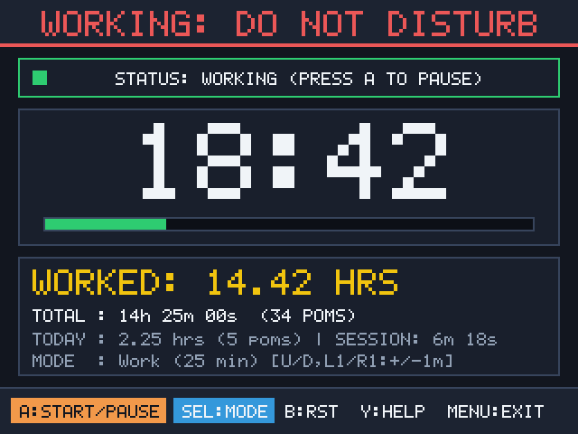
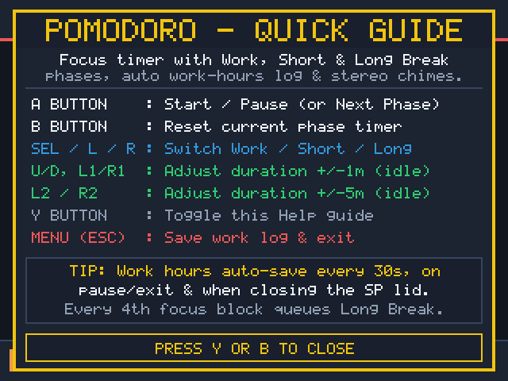

# Anbernic RG 35xxSP Pomodoro Timer (`640x480`)

A distraction-free Pomodoro focus timer and persistent work-hours tracker built from `pomodoro.c` for the **Anbernic RG 35xxSP** clamshell handheld running **Knulli (Scarab / Batocera)** (Allwinner H700 `aarch64`, **640x480** IPS display), plus a native **x86_64 Linux (X11)** target for desktop testing.

| Active Focus Session | Quick Guide & Controls (`Y`) |
| :---: | :---: |
|  |  |

## Features
- **Native 640x480 Display**: Crisp 2x scaled UI (**640x480** 32-bit ARGB) rendered via Knulli's `libSDL2-2.0.so.0` (with automatic fallback to `/dev/fb0`).
- **Clear Status Header**: Displays `"WORKING: DO NOT DISTURB"` in red during Focus blocks, plus clear banners for Short Break, Long Break, Paused, and Completed states. Every 4th completed focus block automatically queues a Long Break when you press **A**.
- **Stereo SoundFont & Singing-Bowl Chimes + Haptic Alert**: Plays a warm 44.1 kHz stereo 3-note arpeggio chime on the background audio thread using SoundFont 2 (`GeneralUser-GS.sf2` / `pocketband.sf2` Vibraphone + Tubular Bells with room reverb, plus a multi-harmonic singing-bowl DSP fallback) and triggers a brief vibration pulse via `/usr/bin/knulli-rumble` on Knulli.
- **Persistent Work Hours Tracking & Lid-Close Save**: Tracks lifetime hours worked (`WORKED: X.XX HRS` and exact `Xh YYm ZZs`), completed Pomodoros, today's hours, and current session time. Auto-saves every 30 seconds while working, on pause/reset/exit, and immediately when closing the RG 35xxSP clamshell lid:
  - **On RG 35xxSP (Knulli)**: Saves to `/userdata/roms/ports/pomodoro/.pomodoro_stats.cfg` and `/userdata/roms/ports/pomodoro/pomodoro_work_log.txt`.
  - **On Linux Desktop**: Saves to `~/.pomodoro_stats.cfg` and `~/pomodoro_work_log.txt`.

---

## Controls (Anbernic RG 35xxSP & Linux Desktop)

| Action | Anbernic RG 35xxSP Button | Linux Desktop Key (`pomodoro_linux`) |
| :--- | :--- | :--- |
| **Start / Pause Timer (or Advance Phase when Done)** | **A** | `A`, `Space`, `Z`, or `Alt` |
| **Reset Current Phase Timer** | **B** | `B`, `Backspace`, or `Ctrl` |
| **Switch Phase (`Work` <-> `Short Break` <-> `Long Break`)** | **SELECT** or **D-Pad LEFT / RIGHT** | `Tab` or `Left` / `Right Arrow` |
| **Adjust Phase Duration (`+/-1 min` while stopped)** | **D-Pad UP / DOWN** or **R1 / L1** | `Up` / `Down Arrow` or `R`/`E`/`]`/`PgDn` and `L`/`Q`/`[`/`PgUp` |
| **Fast Adjust Phase Duration (`+/-5 min` while stopped)** | **R2 / L2** | `2` / `1` |
| **Toggle Quick Guide & Controls Overlay** | **Y** | `Y` |
| **Save Work Log & Exit** | **MENU (`M`)** | `Esc` (or close window) |

---

## Copying to Your Anbernic RG 35xxSP (Knulli SD Card)

Run `make all` to build both binaries and populate `sdcard_package/`:
```bash
cd pomodoro
make all
```

Copy the contents of `sdcard_package/roms/ports/` to `/userdata/roms/ports/` on your Knulli SD card:
- `sdcard_package/roms/ports/Pomodoro.sh` -> `/userdata/roms/ports/Pomodoro.sh`
- `sdcard_package/roms/ports/pomodoro/` -> `/userdata/roms/ports/pomodoro/`

For upgraded Vibraphone + Tubular Bell completion chimes, copy `../soundfonts/GeneralUser-GS.sf2` to `/userdata/roms/ports/soundfonts/GeneralUser-GS.sf2`.

Then in Knulli (EmulationStation), press **START -> Game Settings -> Update Games Lists**, open **Ports**, and launch **Pomodoro**.

---

## Building & Running on Linux Desktop (`x86_64`)

```bash
cd pomodoro
make linux       # builds ./pomodoro_linux
make run-linux   # builds and opens the 640x480 X11 window
```
