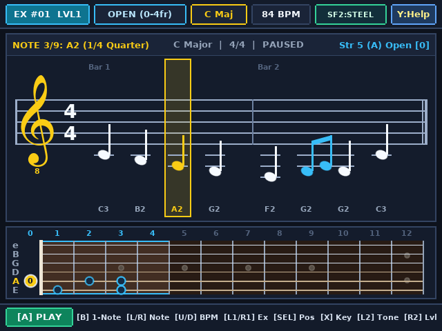
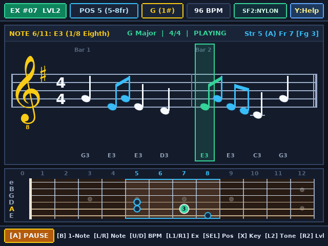
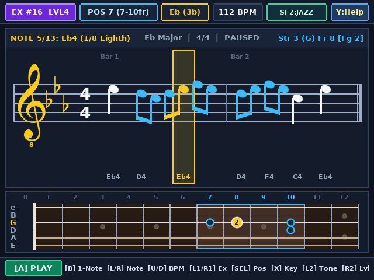
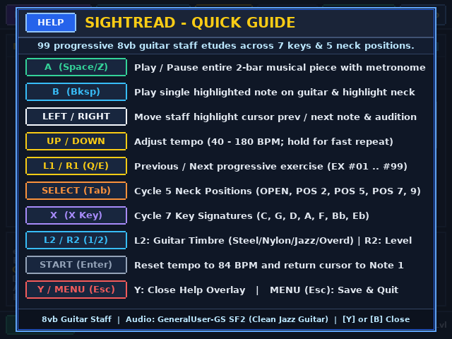

# Anbernic RG 35xxSP Guitar Sight-Reading Trainer (`sightread`, `640×480`)

A native **`640×480`** 32-bit XRGB8888 **Guitar Staff-to-Fretboard Sight-Reading Trainer** built for the **Anbernic RG 35xxSP** (Allwinner H700 64-bit ARM Cortex-A53) and **Linux Desktop (`x86_64` X11)**.

---

## Screenshots

### 1. Open Position (`EX #01 LVL1`, `C Maj`, `SF2:STEEL`)


### 2. 5th Position Playback (`EX #07 LVL2`, `G (1#)`, `SF2:NYLON`)


### 3. Advanced 7th Position (`EX #16 LVL4`, `Eb (3b)`, `SF2:JAZZ`)


### 4. Interactive Controls & Guide (`Y`)


---

## Features

1. **Engraved `640×480` Treble Clef (`8vb`) Staff & Synchronized 12-Fret Rosewood Neck**:
   - Crisp anti-aliased multi-size typography plus high-resolution FreeSerif-engraved **Treble G-Clef (`8vb`)**, **Sharps (`♯`)**, **Flats (`♭`)**, tilted musical oval noteheads, ledger lines (`E2`–`E5`), stems, and slanted eighth-note beams.
   - Lower 12-fret rosewood guitar neck highlights the active **Neck Position** span (`OPEN 0-4fr`, `POS 2 2-5fr`, `POS 5 5-8fr`, `POS 7 7-10fr`, `POS 9 9-12fr`), all notes used in the piece, and the active note with its left-hand finger (`0–4`).
2. **Deterministic Progressive Sight-Reading Engine (`EX #01`–`#99`)**:
   - Generates 2-measure `4/4` sight-reading etudes across **4 progressive difficulty tiers (`LVL1`–`LVL4`)**, **7 key signatures** (`C Maj`, `G (1#)`, `D (2#)`, `A (3#)`, `F (1b)`, `Bb (2b)`, `Eb (3b)`), and **5 neck positions**.
3. **Studio Background-Thread Audio (`GeneralUser-GS.sf2` + Enhanced EKS Fallback)**:
   - Runs 100% of audio synthesis and sample-accurate playback scheduling on a dedicated background audio thread (`rg35xxsp_sf2.h`).
   - Loads `GeneralUser-GS.sf2` for 4 selectable multi-sampled guitar timbres (**Steel Acoustic**, **Nylon Classical**, **Clean Jazz**, **Overdrive Electric**) + GM woodblock metronome clicks with Schroeder stereo room reverb, and falls back seamlessly to a 44.1 kHz floating-point **Extended Karplus-Strong (EKS)** physical-modeling synth if no `.sf2` is found.

---

## Controls (`rg35xxsp_input.h`)

| Action | Anbernic RG 35xxSP Button | Linux Desktop Key (`sightread_linux`) |
| :--- | :--- | :--- |
| **Play / Pause Entire Piece** | **A** | `A`, `Space`, or `Z` |
| **Play Single Highlighted Note** | **B** | `B` or `Backspace` |
| **Move Staff Cursor (Prev / Next Note)** | **D-Pad LEFT / RIGHT** | `Left` / `Right` Arrows |
| **Adjust Tempo (`40–180 BPM`, hold repeat)** | **D-Pad UP / DOWN** | `Up` / `Down` Arrows |
| **Previous / Next Exercise (`EX #01..#99`)** | **L1 / R1** | `L`/`Q`/`[`/`PgUp` and `R`/`E`/`]`/`PgDn` |
| **Cycle 5 Neck Positions (`OPEN`..`POS 9`)** | **SELECT** | `Tab` |
| **Cycle 7 Key Signatures (`C`..`Eb`)** | **X** | `X` |
| **Cycle Guitar Timbre (`Steel`/`Nylon`/`Jazz`/`Overd`)** | **L2** | `1` |
| **Jump Difficulty Tier (`LVL1`–`LVL4`)** | **R2** | `2` |
| **Reset Tempo (`84 BPM`) & Cursor** | **START** | `Enter` |
| **Toggle Help & Guide Overlay** | **Y** | `Y` |
| **Save `.sightread_rg35xxsp.cfg` & Quit** | **MENU** | `Esc` |

---

## Building & Packaging

```bash
cd sightread
make clean all test screenshots
```

- **RG 35xxSP SD Card Package**: `sdcard_package/roms/ports/SightRead.sh` and `sdcard_package/roms/ports/sightread/sightread`
- **SoundFont (Recommended)**: Copy `../soundfonts/GeneralUser-GS.sf2` to `/userdata/roms/ports/soundfonts/GeneralUser-GS.sf2` on your SD card.
- **Linux Desktop X11 Simulator**: `./sightread_linux` (or `make run-linux`)
- **Automated Verification**: `./sightread_linux --verify`
